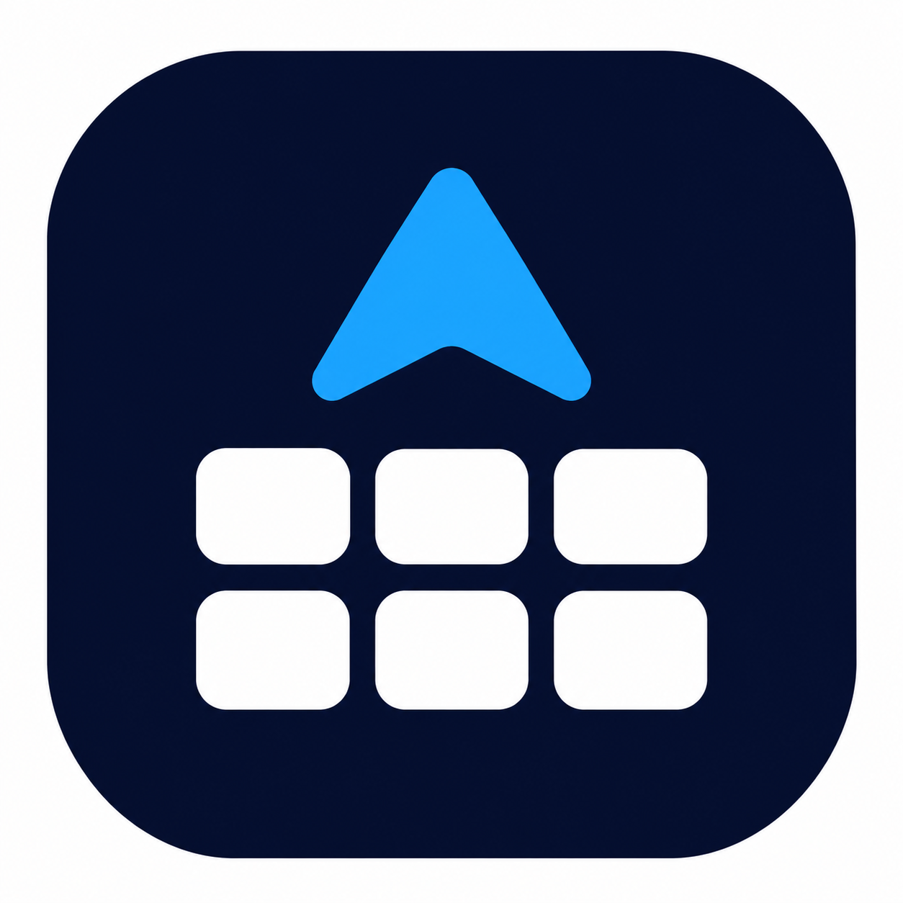

<div align="center">



# DeckPilot

**An open-source, local-first Stream Deck controller and automation app for macOS, Windows and Linux.**

Design your keys around what you want to happen: switch projects, open your tools,
run workflows and time your work, all from a Stream Deck, without a cloud account.

[**Download**](#download) &nbsp;&bull;&nbsp; [Documentation](docs/architecture.md) &nbsp;&bull;&nbsp; [Releases](https://github.com/knittingcode/DeckPilot/releases) &nbsp;&bull;&nbsp; [Report an issue](https://github.com/knittingcode/DeckPilot/issues/new/choose)

[](https://github.com/knittingcode/DeckPilot/actions/workflows/ci.yml)

Apache-2.0 &nbsp;·&nbsp; macOS · Windows · Linux &nbsp;·&nbsp; Pre-release

</div>

> [!NOTE]
> DeckPilot is in **early development**. No release has been published yet; the `v0.6.0-alpha.2`
> draft is verified, and the first public pre-release will be a later 0.6.0-alpha tag. Only the
> Elgato **Stream Deck MK.2** is supported, and it has been tested on real hardware on **macOS** so
> far. See [Supported devices](#supported-devices) and [Known limitations](#known-limitations).

## What is DeckPilot?

DeckPilot turns a Stream Deck into a control surface for your own work. You build a library of
**actions** (open an app, check a repository, call an API, switch projects) and **workflows** that
combine them, then place them on keys. Profiles keep separate setups apart, and projects let the
same key act on whichever project you are working on.

It has two parts:

- **The background agent** talks to the device, runs actions and workflows, and lives in the
  system tray. It starts at login and keeps working when the window is closed.
- **The configuration app** is where you design layouts, actions, workflows and settings. It
  connects to the agent and can be opened and closed at any time.

Everything is stored on your computer, encrypted. There is no cloud service, no account, no
synchronization and no telemetry.

## Why DeckPilot?

- **Action-first.** Decide *what* should happen before deciding which key triggers it. One action
  can sit on several keys, layouts and gestures.
- **Built around projects.** Cycle through your projects from a key; project-aware actions follow
  the active one. Machine-specific paths are bound per computer, so profiles stay portable.
- **Real automation.** A visual workflow editor with conditions, parallel branches, loops,
  retries and timeouts, running in the agent even when the app is closed.
- **Private by design.** Local, always-encrypted configuration; anything that can change your
  system (running commands, starting containers, reaching private networks) is off until you allow
  it on that computer.
- **Cross-platform and open.** One codebase for macOS, Windows and Linux (hardware-tested on macOS
  so far), licensed under Apache-2.0.

## Features

### Stream Deck keys and layouts

Design layouts per device model with a page tree and folders. Keys show live state, colours and
your own PNG or JPEG icons. Each key can react to a **click**, **double click** and **long press**,
with timings you can tune.

### Profiles, projects and resources

**Profiles** are independent sets of actions, workflows, projects and layouts. **Projects** live
inside a profile and are selected in a cycle (`SHOP → CMR → CMS → SHOP`); switching never changes
Git branches, stops containers or closes applications. **Resource bindings** map logical names such
as `shop.repository` to the actual path on each computer.

### Actions from built-in modules

Twelve built-in modules provide the action types; you create the actions you need from them.

| Module | What it does |
| --- | --- |
| General, Projects | Log, wait, cycle and select projects, look up project resources |
| System | Open applications, web pages, files and folders; run commands (off until allowed) |
| Workspace | Open a project's editor and pages |
| Git | Read-only status, branch, changes, last commit and remote state |
| Docker | Containers, Compose status and logs; up, down and restart (off until allowed) |
| HTTP | Requests with headers, query and JSON or text bodies |
| GitHub, GitLab, Jira | Read-only queries against your accounts |
| Notifications | Desktop notifications |
| Work Session | Start, check and finish timed work sessions |

Modules can be turned off without losing their configuration. Credentials are stored encrypted
and chosen from a list, never typed into actions.

### Workflows

Combine actions into graphs in a visual editor: conditions, parallel branches, loops, retries,
timeouts and sub-workflows. Workflows can be started from keys or triggers, show their progress
live, keep a run history, and pass results from one step to the next.

### Work Session

Start, verify and finish a work session from a key. The key shows a live timer, and every session
is kept in a history you can review.

### Variables

One registry for every value a workflow can use: shared variables (`shared.<name>`), project and
profile values, system values and the outputs of earlier steps. The editor offers what is available
in the current context and previews what a reference resolves to.

### Background agent and tray

The agent runs the device and workflows on its own, starts at login, and is controlled from the
tray. The app and the agent negotiate what they support, so a newer app works with an older agent
for what both understand.

### Encrypted configuration, export and import

The configuration is always encrypted with SQLCipher. By default the key is kept in the operating
system's credential store (macOS Keychain, Windows Credential Manager, Secret Service); you can use
a password instead. Encrypted exports are the backup and move a configuration to another computer.

<!--
  App preview: the screenshot gallery goes here once the images exist in
  .github/assets/screenshots/ (see the README there): main dashboard,
  device view, profiles and projects, action editor, workflow editor,
  Work Session, settings and modules.
-->

## Download

No release has been published yet. The `v0.6.0-alpha.2` draft is verified but not published; the
first public pre-release will be a later **0.6.0-alpha** tag and will appear on the
[Releases page](https://github.com/knittingcode/DeckPilot/releases) with these installers:

| Platform | Installer | Notes |
| --- | --- | --- |
| macOS, Apple Silicon | `DeckPilot_<version>_aarch64.dmg` | Signed with Developer ID and notarized by Apple |
| macOS, Intel | `DeckPilot_<version>_x64.dmg` | Signed with Developer ID and notarized by Apple |
| Windows, x64 | `DeckPilot_<version>_x64-setup.exe` or `_x64_en-US.msi` | Not code-signed yet: SmartScreen warns on first start |
| Linux, x64 | `.AppImage` or `.deb` (stable releases also `.rpm`) | The `.deb` and `.rpm` install the udev rule for the device |

Pre-releases are marked as such on GitHub and are never offered to installations that follow the
stable channel. Every update is signed, and the app verifies the signature before installing it.

On Linux with the AppImage, install
[`packaging/linux/70-deckpilot-streamdeck.rules`](packaging/linux/70-deckpilot-streamdeck.rules)
so the Stream Deck can be used without root.

## Getting started

1. Install DeckPilot and start it. The agent starts with it and appears in the tray.
2. Connect a Stream Deck MK.2. It appears under **Settings → Devices**.
3. On first start DeckPilot creates its encrypted configuration and keeps the key in the system
   credential store, so it opens without a password. You can switch to a password under
   **Settings → Security**.
4. Create a profile, add your projects, and bind each project's resources (folders, repositories)
   on this computer.
5. Create actions from the modules you need, place them on keys in the layout editor, and combine
   them into workflows when one action is not enough.
6. Make an encrypted export: it is your backup.

## Supported devices

| Model | macOS | Windows | Linux |
| --- | --- | --- | --- |
| Stream Deck MK.2 | Tested on hardware | Automated tests only | Automated tests only |
| Stream Deck XL | Layouts only, no driver | Layouts only, no driver | Layouts only, no driver |
| Stream Deck + | Layouts only, no driver | Layouts only, no driver | Layouts only, no driver |

Only the MK.2 has a driver; other models are not shown as supported devices. Using several devices
at once has not been tested. Details: [Devices](docs/devices.md#verification-levels).

## Security and privacy

- **Local-first.** Configuration, history and credentials stay on your computer; nothing is sent
  anywhere unless an action you created does so. The one exception is the update check: while the
  app is open it asks GitHub Releases for a newer version, daily by default (Settings → Updates,
  *Check automatically while DeckPilot is open*; see [docs/updates.md](docs/updates.md)).
- **Encrypted at rest.** SQLCipher (AES-256) for the whole configuration, with the key in the system
  credential store or derived from your password (Argon2id). Exports are encrypted separately.
- **Locking.** Manual and automatic lock, Touch ID on macOS, and re-authentication for sensitive
  operations such as exports.
- **Signed releases and updates.** macOS builds are signed and notarized; every update is signed
  and checked against the key built into the app before it is installed.
- **Explicit permissions.** Running commands, changing containers and reaching private networks
  or self-hosted services are off until allowed on each computer.

Read the details in [docs/security.md](docs/security.md). Report vulnerabilities privately as
described in [SECURITY.md](SECURITY.md).

## Architecture

DeckPilot is written in **Rust** with a **Tauri 2** desktop app whose interface uses **React**,
**TypeScript**, Tailwind and shadcn/ui. Configuration is stored in **SQLite with SQLCipher**.

```
Stream Deck  ⇄  agent (Rust: devices, actions, workflows, tray)  ⇄  local IPC  ⇄  app (Tauri 2 + React)
                      │
                      └── encrypted configuration (SQLCipher)
```

| Area | Where |
| --- | --- |
| Device models, drivers, rendering | `crates/deckpilot-device`, `deckpilot-hid`, `deckpilot-render` |
| Actions, workflows, profiles, variables | `crates/deckpilot-core`, `modules/*` |
| Storage, key store, export | `crates/deckpilot-storage`, `deckpilot-keystore`, `deckpilot-portability` |
| Agent, IPC, updates | `apps/agent`, `crates/deckpilot-ipc`, `deckpilot-update` |
| Configuration app | `apps/desktop` |

More: [Architecture](docs/architecture.md) · [Background agent](docs/background-agent.md) ·
[Modules](docs/modules.md) · [Workflows](docs/workflow-graphs.md) · [Variables](docs/variables.md) ·
[Data model](docs/data-model.md) · [Updates](docs/updates.md)

## Development

You need Rust via rustup (the toolchain is pinned in `rust-toolchain.toml`), Node.js 22 or newer,
pnpm, and the [Tauri prerequisites](https://tauri.app/start/prerequisites/) for your system.

```sh
make setup    # dependencies and toolchain check
make up       # agent with simulated devices + configuration app with live reload
make status   # what is running
make check    # lint and tests
make down     # stop; development data in .dev/ is kept
```

Development uses its own database in `.dev/data` with demonstration data and never touches your
real configuration. `pnpm dev` runs the same session in the foreground. All commands:
[docs/development.md](docs/development.md).

## Known limitations

- Only the Stream Deck MK.2 is supported, and it has been tried on hardware on macOS only.
- No release has been published; automatic installation of updates stays off by default until an
  update between two real releases has been tested.
- Windows installers are not code-signed yet.
- Device discovery rescans every two seconds instead of using hotplug notifications.
- On Linux desktops without AppIndicator support the tray icon is not shown (the agent keeps
  working).
- Touch ID on macOS is the only system authentication; Windows Hello and polkit are not integrated.
- Locking with the screen lock is detected on macOS and Linux, not on Windows.
- The app and agent have been run by hand on macOS; on Windows and Linux they are covered by CI.

## Roadmap

Planned work is tracked in [docs/roadmap.md](docs/roadmap.md): drivers for more Stream Deck
models, hardware testing on Windows and Linux, and Windows code signing. Cloud synchronization and
telemetry are out of scope. A plugin marketplace is a design proposal
([#191](https://github.com/knittingcode/DeckPilot/pull/191)) with experimental feasibility work; it
is not part of DeckPilot.

## Contributing

Contributions are welcome. Read [CONTRIBUTING.md](CONTRIBUTING.md) and the
[Code of Conduct](CODE_OF_CONDUCT.md), and use the
[issue templates](https://github.com/knittingcode/DeckPilot/issues/new/choose) for bugs and ideas.

## License

DeckPilot is licensed under the [Apache License, Version 2.0](LICENSE).
