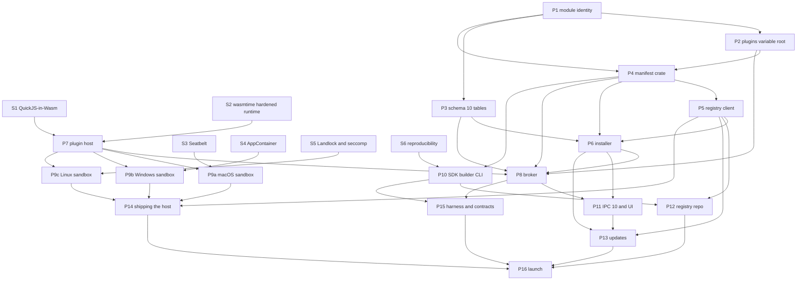

# Plugin marketplace: architecture

Status: **Proposed.** Supersedes the "Plugin marketplace: out of scope"
entry in `docs/roadmap.md` and the "no third-party code / no remote
installation" statement in `docs/modules.md` once accepted. This pull request
changes neither file; that is the owner's decision (see
[§19.3](#193-required-doc-changes-on-acceptance)).

Baseline: `main` at `e7a3cc9` (2026-11-13). Code references were checked
against that commit. Nothing in this document is implemented.

Companion files:

| File | What it is |
| --- | --- |
| [`schemas/plugin-manifest.schema.json`](schemas/plugin-manifest.schema.json) | Manifest JSON Schema (draft 2020-12), section 7 |
| [`schemas/registry-index.schema.json`](schemas/registry-index.schema.json) | Signed registry index, section 10 |
| [`schemas/registry-plugin.schema.json`](schemas/registry-plugin.schema.json) | Per-plugin detail with versions, section 10 |
| [`schemas/registry-timestamp.schema.json`](schemas/registry-timestamp.schema.json) | Freshness document, section 10 |
| [`schemas/registry-keyset.schema.json`](schemas/registry-keyset.schema.json) | Key-set chain, section 9 |
| [`sdk.d.ts`](sdk.d.ts) | SDK interface declarations (design artifact, not a published package), section 6 |
| [`example-plugin/`](example-plugin/) | `manifest.json`, `index.ts` and the generated `deckpilot-env.d.ts` of the example plugin |
| [`tsconfig.json`](tsconfig.json) | Lets the repository's lint and type checks cover `sdk.d.ts` and the example |

The example manifest validates against the manifest schema (checked with
`ajv-cli` 5.0.0 and `ajv-formats` 3.0.1, draft 2020-12, strict mode except
`strictRequired`). The registry schemas were checked against sample
documents the same way, and the example `index.ts` type-checks against
`sdk.d.ts` with `tsc` and passes `eslint`.

## Decision summary

| Topic | Decision | Section |
| --- | --- | --- |
| Plugin language | TypeScript compiled to one ES2022 module (`plugin.js`). No native code, no plugin-supplied Wasm | 3, 8 |
| Runtime | QuickJS-NG compiled to Wasm, run by wasmtime inside a per-plugin `deckpilot-plugin-host` process that sandboxes itself at the OS level. The agent is the only broker | 3 |
| Isolation | Two independent layers on every platform (Wasm and OS sandbox). A platform where the OS layer is not proven gets no plugins | 3, 16 |
| Permissions | Declared in the manifest, consented at install, stored in the encrypted DB, enforced in the agent per call | 5 |
| Credentials | Per-plugin secret slots in a new table; plugins get handles, never values | 5, 6 |
| Variables | Fixed root `plugins.<publisherCamel>.<nameCamel>.*` | 2.3, 6 |
| Identity | Plugin id `<publisher>.<name>`; it is the module id; action ids are `<publisher>.<name>.<action>` | 2.3, 7 |
| Signing | minisign (Ed25519) with three registry roles: offline root, reviewer-gated index, unattended timestamp. Separate from the app updater key | 9 |
| Bytes | Built by the registry's CI from a pinned commit and published as immutable GitHub Releases in `knittingcode/deckpilot-plugins` | 8, 11 |
| Discovery | Static files on GitHub Pages; no GitHub API calls from clients | 10, 11 |
| Install | Staging directory, verification before parsing, consent, crash-safe rename, then one DB transaction | 12 |
| Updates | Escalations never apply silently; the previous version is kept for rollback | 13 |

## Constraints

- **GitHub only**: a repository, GitHub Pages, GitHub Releases and GitHub
  Actions. No backend, no hosted database, no accounts, no paid services.
  The SDK and tooling are distributed as npm tarballs attached to GitHub
  Releases, not through the npm registry ([§20](#20-unresolved-technical-decisions), U-9).
- **Community pull requests never reach signing credentials.** Community
  submissions go to a separate repository whose PR workflows have no
  secrets, no `id-token` and a read-only token (section 11).
- **Separate keys** from the app updater: different repository, different
  environments, different secrets, different key pairs, domain-separated
  signatures (section 9).
- **No large monorepo restructure.** DeckPilot gains a few crates and one
  binary; the registry, SDK and builder live in the new repository.
- **Backward compatibility**: existing modules, actions, workflows,
  variables, profiles, layouts, encrypted storage and device adapters keep
  working unchanged (§2.3).

## 1. Current architecture inventory

What exists today and matters for plugins. Paths are relative to the
repository root; line numbers are from `e7a3cc9`.

### 1.1 Modules

- `crates/deckpilot-core/src/module.rs` says "there is no dynamic loading"
  (line 6). `ModuleId` (line 42) accepts `[a-z][a-z0-9-]{0,63}`, so it has
  no `.`. `ModuleId::owner_of` (line 74) takes the text before the
  **first** `.` of an action type id.
- `ModuleManifest` (line 257): id, version, name, description, platforms,
  pages, capabilities, config (`Vec<ParameterSpec>`), dependencies,
  `enabled_by_default`, portability, migrations (SQL, line 277), windows,
  variables.
- `Capability` (line 104): `ProfileRead`, `ProjectContext`,
  `MachineResources`, `OpenExternal`, `ProcessExecution`, `ProcessInspect`,
  `Network`, `Notifications`, `Credentials`, `VariablesRead`.
- `trait FeatureModule` (line 293): `manifest()`, `action_handlers(config)`,
  `variable_source()`.
- `ModuleRegistry::register` (line 431) checks that every action type and
  window is inside the module's namespace (windows with `split_once('.')`
  at line 445, action types with `owner_of` at line 456), refuses duplicates and registers variables all or
  nothing. `unregister` (487), `set_enabled` (536), `apply_states` (585),
  `availability` (760), `action_registry` (786). `Availability` (364) and
  `ModuleInfo` (377) are what the app receives.
- `crates/deckpilot-modules/src/lib.rs` `builtin(os)` registers 12 modules
  (general, projects, system, git, docker, http, notifications, github,
  gitlab, jira, workspace, work-session), each with
  `.expect("built-in modules do not conflict")`.
- The agent rebuilds the registry after unlock and on every reload
  (`apps/agent/src/service.rs` `load_modules`, line 1424).
- Module settings live in the `modules` table. `ConfigStore::module_states`
  (`crates/deckpilot-storage/src/sqlite.rs` line 1769) skips rows whose id
  this build cannot parse, so unknown ids never prevent start-up.
- Module SQL migrations run with full access to the encrypted database; no
  table prefix is enforced.
- `docs/modules.md` "Security boundary": capabilities "protect against
  mistakes … it is not a sandbox against hostile code".

### 1.2 Actions, workflows and button state

- `ParameterKind` (`crates/deckpilot-core/src/action.rs` line 53, serde
  `tag = "type"`, camelCase): text, integer, boolean, choice, resource,
  project, lines, pairs, code, credential. `ParameterValue` (line 170) adds
  `reference` and `template`, which the engine resolves before a handler
  runs. `looks_secret` is at line 122.
- `ActionHandler` (`crates/deckpilot-core/src/registry.rs`) runs
  synchronously. `ActionRegistry::dispatch` (line 296) restricts the
  execution context to the module's capabilities.
- **`Request::RunAction` runs on the agent's single service task**
  (`apps/agent/src/service.rs` lines 764-771); key presses use the same
  path. A slow handler there stalls devices and IPC.
- `NodeSpec` (`crates/deckpilot-core/src/graph/mod.rs`): version, icon,
  outputs, `timeout_ms` (at most `MAX_TIMEOUT_MS` = 10 min), `retry_safe`,
  idempotent, `changes_context`, cancellable, effect. `ValueKind`: text,
  integer, boolean, path, url, projectKey.
- `ButtonState` (`crates/deckpilot-core/src/button_state.rs` line 50):
  label, detail, indicator (ok, warning, error, running, unknown, loading),
  progress, toggle. Texts are limited to `MAX_STATE_TEXT` = 32 characters.
- Button states: at most `MAX_RUNNING` = 4 providers, `CALL_TIMEOUT` = 20 s
  (`apps/agent/src/service/states.rs` lines 43, 45). Workflow executions:
  at most 4 (`apps/agent/src/service/executions.rs` line 50).

### 1.3 Variables

- `crates/deckpilot-core/src/variables/registry.rs`: `RESERVED_ROOTS =
  ["steps", "shared", "system", "workflow"]` (line 45),
  `MODULE_NAMESPACES = ["projects", "workSession"]` (line 53),
  `MAX_ID_SEGMENTS = 6` (line 55), `module_namespace` (line 134, kebab to
  lowerCamel), `register_module` (line 610), `ALIASES` (line 309).
- `VariableRef::parse` (`variables/expression.rs` line 213) accepts a
  module root only if it is in `MODULE_NAMESPACES`.
  `apps/desktop/src/lib/variables.ts` line 76 mirrors the constant.

### 1.4 Credentials and keystore

- `credentials(id, description, secret, updated_at)` is inside the
  SQLCipher database (`crates/deckpilot-storage/src/credentials.rs`), never
  exported. `CredentialId` allows `[a-z][a-z0-9._-]`, at most 64 characters
  (`crates/deckpilot-core/src/credentials.rs` line 32); the app mirrors it
  (`apps/desktop/src/lib/structured.ts` line 93).
- Credentials are global: any module with `Capability::Credentials` reads
  any id (`crates/deckpilot-core/src/execution.rs` line 225). The agent
  loads all of them into memory on reload (`apps/agent/src/service.rs`
  around line 1060).
- The keystore (`crates/deckpilot-keystore`) holds only database keys.

### 1.5 Storage

- `MIGRATIONS` (`crates/deckpilot-storage/src/sqlite.rs` line 27) has 9
  entries, so the schema is 9: core; app launches; legacy (with `modules`);
  document rewrite; `migration_history` and `module_schemas`; executions;
  credentials; shared variables; work sessions. The store backs up before
  an upgrade and refuses a newer database.

### 1.6 IPC

- `crates/deckpilot-ipc/src/protocol.rs`: `PROTOCOL_VERSION = 9` (line 67),
  `MIN_PROTOCOL_VERSION = 1` (160), `MIN_COMPATIBLE_AGENT_PROTOCOL = 4`
  (165). Connection capabilities with `since_protocol` (214) and
  `of_protocol` (228); `Response::for_protocol` (606);
  `Request::since_protocol` (745); event `since_protocol` (800). The rules
  are in [compatibility.md](../compatibility.md#protocol-negotiation).
- The token is in `<data dir>/agent.token`, readable by the user. **Any
  process running as the same user can read it and ask the agent for the
  database key** (`getDatabaseKey`;
  [security.md](../security.md#trust-boundary-between-the-app-and-the-agent)).

### 1.7 Devices

- `crates/deckpilot-device`: `DeviceBackend`, `DeviceHandle`,
  `DeviceDescriptor`, capability families keys, keyDisplays, dials,
  touchStrip, brightness; `ModelCatalog::register_missing` (catalog.rs line
  202). `MockBackend` and the agent flags `--mock-devices`, `--no-usb`,
  `--headless` (`apps/agent/src/main.rs` line 18).

### 1.8 Desktop app

- CSP `default-src 'self' ipc: http://ipc.localhost; img-src 'self' data:;
  style-src 'self' 'unsafe-inline'`; macOS `hardenedRuntime: true`
  (`apps/desktop/src-tauri/tauri.conf.json` lines 29, 39).
- Module settings forms and action forms are generated from
  `ParameterSpec`. A plugin needs no frontend code if it contributes only
  actions, settings and variables.

### 1.9 Updates and releases

- `crates/deckpilot-update`: `signature::verify` (minisign, base64 Tauri
  format, `signature.rs` line 47), `verify_release_artifact` (line 59,
  binds `version:` in the trusted comment), constants `REPOSITORY`,
  `STABLE_ENDPOINT`, `DOWNLOAD_PREFIX` (`lib.rs` lines 25-38). The updater
  key is compiled in from `DECKPILOT_UPDATER_PUBKEY`
  (`apps/desktop/src-tauri/src/updates.rs` line 40).
- `release.yml` follows gate → environment check → draft → verify →
  approval → publish, with `tools/release-pipeline/check-workflow-gate.py`
  and `check-environment.sh`. The research for this design observed (read
  only) that immutable releases are enabled on `knittingcode/DeckPilot`.

### 1.10 Corrections to the research reports

| Report claim | Finding |
| --- | --- |
| "rquickjs switched to quickjs-ng in 0.11.0" | The rquickjs changelog lists the switch in **0.10.0** (2025-10-24); 0.11.0 (2025-12) bumped the pinned quickjs-ng commit |
| SDK manifest `$id` on `schemas.deckpilot.dev` | A custom domain contradicts the GitHub-only constraint and adds a takeover risk. All `$id`s use `knittingcode.github.io/deckpilot-plugins` |
| Default credential name `<plugin id>.<key>` in the global table | Does not fit `CredentialId` (64 characters, lowercase only). Plugins get their own table instead (§5.5) |
| Indicator `loading` "added by the SDK" | It already exists in the core `Indicator` enum |
| Example plugin returned the undeclared code `invalid-response` | Declared in the example manifest |
| Javy "dynamic" mode as the plugin format | Javy dynamically linked modules carry QuickJS bytecode, and QuickJS's bytecode reader is not hardened. Plugins ship JS source only (§3.4) |

## 2. Reuse versus new implementation

### 2.1 Reused as is

| Existing piece | Used for |
| --- | --- |
| `ModuleManifest`, `FeatureModule`, `ModuleRegistry::register` | A plugin is registered as one more module by an adapter (`PluginModule`) |
| `ModuleStates` and the `modules` table | Enabled flag and settings of a plugin, keyed by its module id |
| `Availability` and "kept, shown unavailable" | Actions of a disabled, uninstalled or revoked plugin |
| `ParameterSpec`, `NodeSpec`, `OutputSpec`, `VariableDeclaration`, `ButtonState` | Same JSON in the manifest; the app renders them with the existing generated forms |
| `ActionRegistry::dispatch` capability restriction | First check; the broker adds plugin-only scopes |
| HTTP module client and `NetworkPolicy` (`modules/http/src/client.rs`, `policy.rs`) | `ctx.http.fetch` |
| `Redactor`, `looks_secret`, 500-character message limit | Plugin results and logs |
| `deckpilot_update::signature::verify` | Every registry signature, wrapped with a role check |
| `Channel::accepts` semantics | Plugin channels: stable never takes a pre-release, never a downgrade |
| IPC `since_protocol` / `for_protocol` / `of_protocol` | Protocol 10 |
| Release pipeline shape and `check-workflow-gate.py` | Template for the registry workflows |
| `MockBackend`, `--mock-devices`, `simulateInput` | Plugin integration tests |
| Contract tests (`crates/deckpilot-modules/tests/contracts.rs`) | Plugin contract tests |

### 2.2 New

| New piece | Where | Section |
| --- | --- | --- |
| Manifest types, validation, permission normalization and diff | `crates/deckpilot-plugins` (new) | 7, 13 |
| Registry client | `crates/deckpilot-registry` (new) | 9, 10 |
| Installer and package reader | `crates/deckpilot-plugins` | 8, 12 |
| Broker, `PluginModule`, host supervision | `apps/agent/src/plugins/` (new module) | 3, 5 |
| Plugin host binary with wasmtime and OS sandbox | `apps/plugin-host` (new binary crate) | 3 |
| QuickJS-NG Wasm engine build | `apps/plugin-host/engine/` | 3 |
| Schema 10 tables | `crates/deckpilot-storage` | 12 |
| IPC protocol 10 | `crates/deckpilot-ipc` | 2.3 |
| Plugins pages, consent and diff dialogs | `apps/desktop/src/settings/` | 12, 13 |
| Registry repository, SDK, builder, CLI, test harness | `knittingcode/deckpilot-plugins` (new repository) | 11, 15 |

### 2.3 Backward compatibility and migration

Every item below is additive. A DeckPilot build without plugins installed
behaves exactly as today.

1. **Module id grammar.** `ModuleId::new` keeps accepting
   `[a-z][a-z0-9-]{0,63}` (built-ins never contain `.`) and additionally
   accepts exactly one `.` when both halves match the plugin grammar
   (publisher `^[a-z][a-z0-9]*(-[a-z][a-z0-9]*)*$`, 2-24 characters; name the
   same, 2-32 characters). Built-in ids therefore never contain a dot and
   plugin ids always contain exactly one. A plugin id is a valid module id,
   so `ModuleStates`, the `modules` table and `ModuleInfo` need no format
   change. Rows written by a newer build are still skipped by older builds
   (`module_states` ignores unparsable ids).
2. **`owner_of` splits at the last dot.** `ModuleId::owner_of` becomes
   `rsplit_once('.')`. Every built-in action type has exactly one dot
   (`<module>.<name>`); the only multi-dot ids ever stored were the legacy
   `deckpilot.core.*`/`deckpilot.project.*`/`deckpilot.resource.*` types,
   which schema 3 rewrote (`crates/deckpilot-storage/src/legacy.rs`). So
   owners of existing ids do not change. A contract test asserts that every
   built-in action type has two segments and that plugin action types have
   three. The window checks in `register` and `ModuleRegistry::window` keep
   `split_once` because plugins cannot declare windows.
   Behaviour change for unknown ids only: an imported `a.b.c` used to
   report owner `a`; it now reports `a.b` (a plugin id). Both are
   "unavailable", so nothing visible changes.
3. **Dynamic variable namespaces.** A new fixed root `plugins` joins
   `RESERVED_ROOTS`. `VariableRef::parse` accepts
   `plugins.<publisherCamel>.<nameCamel>.<path>` whenever it is a
   syntactically valid `VariableId` (at most 6 segments, so at most 3 path
   segments), without consulting a list. `MODULE_NAMESPACES` stays the
   constant list of built-in roots. `register_module` accepts, for a plugin
   module, exactly the namespace `plugins.` + `module_namespace(publisher)`
   + `.` + `module_namespace(name)` and compares by prefix. The app's
   `referenceRoot` treats `plugins` like a module root and takes names from
   the catalog. References stored in workflows therefore parse on every
   machine, whether or not the plugin was ever installed there, and resolve
   as `Resolution::Unavailable { owner }` when it is not.
4. **Persisted known-plugin namespaces.** The agent records every plugin it
   ever installed in `plugin_known` (id, namespace, display name,
   publisher). The table only grows. It gives uninstalled owners a display
   name in "unavailable" messages and lets the variable picker list
   references to plugins that are no longer installed. It is not needed for
   parsing.
5. **Per-plugin credential scope.** Plugin secrets live in a new table
   `plugin_credentials(plugin_id, key, secret, updated_at)`, not in
   `credentials`. Built-in modules cannot see them, plugins cannot see the
   global table, and the global `CredentialId` grammar is unchanged.
6. **No module SQL migrations for plugins.** `ModuleManifest.migrations`
   stays built-in only and is always empty for plugins. Plugins get a
   per-plugin key-value store (`plugin_storage`) with a quota instead.
7. **IPC protocol 10.** `PROTOCOL_VERSION` becomes 10, with a connection
   capability `plugins` (`since_protocol` 10) and new requests (§12.6)
   whose `Request::since_protocol` is 10. `ModuleInfo` gains `origin` and
   `grants` with serde defaults. `Response::for_protocol(protocol < 10)`
   removes plugin modules and their action types from module lists and
   catalogs, so an older app never offers actions whose owner it cannot
   explain; instances in profiles stay and show as unavailable. The client
   refuses plugin requests to an agent below 10 locally
   (`ClientError::Unsupported`), and plugin events are not sent to older
   clients. `MIN_COMPATIBLE_AGENT_PROTOCOL` stays 4.
8. **Schema 10.** One new migration adds the plugin tables (§12.4). The
   existing backup-before-upgrade path applies; older builds refuse the
   newer database as today.
9. **Exports.** Plugin settings travel in the existing `modules` map of the
   export payload (keyed by `String`), following each setting's declared
   portability. Plugin secrets, storage and grants are never exported. An
   importing build that lacks the plugin reports its data like that of any
   absent module (existing behaviour).
10. **Preserved unchanged**: built-in modules and their ids, action types,
    workflows and graphs (`GRAPH_VERSION` 1), variables and `ALIASES`,
    profiles and layouts, the encrypted storage format and keystore, device
    adapters and the model catalog, the updater and its key.

## 3. Recommended plugin runtime

### 3.1 Crash isolation is not security isolation

- **Crash isolation**: a plugin bug (panic, infinite loop, out of memory)
  cannot take down the agent or other plugins. A separate process gives
  this.
- **Security isolation**: a hostile plugin cannot use authority it was not
  granted. A separate process does **not** give this. A process the agent
  starts runs as the user, with the user's files, network and keychain.
- **IPC alone is not a sandbox.** Routing plugin capabilities through IPC
  constrains only code that chooses to use the IPC. In DeckPilot this is
  worse than usual: any same-user process can read `agent.token`, connect
  to the agent's endpoint and send `getDatabaseKey`. A plugin that reaches
  native code execution without an OS sandbox has the database key, every
  credential and every file.

Security isolation therefore needs a runtime without ambient authority
**and** an OS sandbox around it. This design requires both.

### 3.2 Layers

```text
plugin.ts --(registry builder: esbuild)--> plugin.js (one ES module, JS source only)

deckpilot-agent                                   deckpilot-plugin-host (one process per plugin)
  broker: grants, http, credentials,  <-------->    1. OS sandbox applied to itself before any plugin byte
  storage, variables, device state,  inherited     2. wasmtime Store: epoch deadline, StoreLimits
  notifications, audit               fd / handle   3. engine.wasm (QuickJS-NG, built and signed with the app)
                                     only          4. plugin.js evaluated by the engine
```

Outermost to innermost:

1. **Distribution integrity**: signed registry, pinned package hashes
   (sections 9, 12).
2. **Consent**: stored per plugin and grant (section 5).
3. **Broker in the agent**: the only place where a plugin's request turns
   into an effect. Identity comes from the channel the request arrived on.
4. **OS sandbox** of the host process: no file system, no network, no
   process creation, no keychain, no access to `agent.token` or the IPC
   endpoint (§3.5).
5. **Wasm sandbox**: QuickJS runs in linear memory with no WASI file
   system, sockets, environment or arguments. The only imports are
   DeckPilot's host functions.
6. **Resource limits** (§3.6).

The Wasm layer is the primary boundary against a malicious script and
against QuickJS memory-safety bugs; it is identical on every platform. The
OS layer is defense in depth against a wasmtime escape; its strength
differs per platform (section 16). That unevenness is the main argument for
having the Wasm layer at all.

### 3.3 Alternatives considered

| Option | Verdict |
| --- | --- |
| JS engine inside the agent (rquickjs, Boa, V8 via `deno_core`) | Rejected. An engine bug runs in the process that holds the database key, the decrypted page cache and the HID handles; an abort or stack overflow kills the agent |
| Node, Deno or Bun as host | Rejected. Tens of MB per platform to ship and patch (estimate); V8 attack surface; Node's own documentation says its permission model gives no guarantees against malicious code; authors would expect `fs` and native modules that must be denied anyway |
| Native QuickJS in a sandboxed host, no Wasm | Rejected for v1. Simpler and faster, but a QuickJS memory bug would land directly on the OS sandbox, which is weakest on macOS (deprecated interface) and old Linux kernels |
| SpiderMonkey via ComponentizeJS/StarlingMonkey | Deferred. Better JS performance and typed WIT, but a much larger engine (several MB per component, estimate) and slower builds. The host API is designed so the engine can be swapped |
| Shared host for all plugins | Rejected. One crash restarts all; only Wasm separates plugins; no per-plugin kill or limits |

### 3.4 Engine

- **QuickJS-NG compiled to `wasm32-wasip1`**, linked with no WASI imports
  except clocks and random. DeckPilot builds it in the app's release
  pipeline, precompiles it for each target at build time and embeds the
  result in the host binary. The host never deserializes compiled code from
  anywhere else (`Module::deserialize` is `unsafe` for that reason).
- **Plugins ship JS source only.** No QuickJS bytecode, no Wasm. The engine
  parses `plugin.js` inside the sandbox, so a parser bug stays inside both
  layers. Javy's dynamically linked modules (QuickJS bytecode) are
  therefore not used as the plugin format.
- Spike S1 decides between Javy's plugin API (`javy-plugin-api`) and an own
  rquickjs build to `wasm32-wasip1`; the choice does not change the host
  API.
- Cranelift (JIT) or Pulley (interpreter): spike S2. If the macOS
  entitlement `com.apple.security.cs.allow-jit` on the helper is acceptable
  and notarization passes, Cranelift; otherwise Pulley on that platform.
  Pulley is also required on Windows if Arbitrary Code Guard is enabled
  (not planned for v1).
- `eval`, `new Function` and `WebAssembly` are disabled in the engine
  build, not only by static checks.

### 3.5 Process model and OS sandbox

- **One `deckpilot-plugin-host` process per plugin**, started by the agent
  only. The binary ships next to the agent in every package.
- The agent starts it with an empty environment, the working directory set
  to the file system root, no arguments except the inherited channel
  descriptor, and exactly one inherited channel: a `socketpair` on macOS
  and Linux, an anonymous pipe pair passed with
  `PROC_THREAD_ATTRIBUTE_HANDLE_LIST` on Windows.
- The host applies its sandbox to itself **before** it receives any plugin
  byte. It never opens a file after start-up: the agent sends `plugin.js`
  over the channel after verifying it.
- Per platform:

| Platform | Mechanism (v1) | Must deny |
| --- | --- | --- |
| macOS | Seatbelt self-sandbox (`sandbox_init` with an SBPL profile, `(deny default)`), hardened runtime; `allow-jit` only on the helper if S2 chooses Cranelift | file reads outside the helper's own code, all writes, all network, `process-exec*`, `mach-lookup` except what wasmtime needs; explicitly the data directory, the agent socket and Keychain services |
| Windows | AppContainer (LPAC where available) with no capabilities, Job Object (memory limit, one active process, kill on close, UI restrictions) | the user's files and registry, network, the agent's named pipe (its DACL grants only owner and SYSTEM), child processes |
| Linux | `no_new_privs` + seccomp-bpf allowlist + Landlock (best available ABI) + rlimits (`RLIMIT_NPROC`, `RLIMIT_NOFILE`, `RLIMIT_CORE=0`, `PR_SET_DUMPABLE=0`; never `RLIMIT_AS`) | `open*`, `socket`, `connect`, `execve`, `ptrace`; the D-Bus session socket (Secret Service has no per-application ACL) |

- The macOS Seatbelt interface is deprecated and undocumented. The
  fallback, if S3 fails or a macOS release breaks it, is an XPC service or
  helper app with the App Sandbox entitlement. A helper signed with App
  Sandbox cannot simply be spawned by a non-sandboxed parent (Apple
  Developer Forums thread 706390, "Resolving App Sandbox Inheritance
  Problems"); the spike must prove a launch path.

### 3.6 Limits

| Limit | Value | Enforced by |
| --- | --- | --- |
| Continuous guest execution between two host yields | 250 ms | wasmtime epoch deadline |
| Module evaluation plus `onActivate` | 2 s | epoch deadline and agent timer |
| Action `run` wall clock | `node.timeoutMs` (default 30 s, at most 10 min) | agent |
| `state` wall clock | 20 s (`CALL_TIMEOUT`) | agent |
| Timer callback | 30 s | agent |
| `onDeactivate` | 5 s, then the process is killed | agent |
| Linear memory | 64 MiB per Store | `StoreLimits` |
| Process memory | 128 MiB (estimate, confirmed in S1) | Windows: Job Object limit; macOS and Linux: the agent samples the host's resident memory and kills it above the limit |
| Concurrent invocations per plugin | 8; further calls queue up to 32, then `throttled` | agent |
| Frame size | agent to host 2 MiB, host to agent 256 KiB | both sides |

On a trap, timeout or memory limit the Store is discarded (never reused
after a trap; see CVE-2026-104855 below) and the process exits. The agent
restarts it with backoff 1, 2, 4 … 60 s. Five crashes within 10 minutes
disable the plugin with reason `crashed`; the user re-enables it.
Plugins without the `background` permission are stopped after 10 minutes
without calls and started again on demand.

CVE-2026-104855 (wasmtime: preemption and traps during bulk operations can
break internal VM state; fixed in 46.0.2, 47.0.3 and 48.0.0) shows why a
Store is never reused after a trap or timeout. wasmtime publishes security
point releases frequently (several advisories affected 49.0.0 alone), so
the host tracks the newest patch release of a supported wasmtime version
(release criterion R-7).

### 3.7 Agent side

- `PluginModule` implements `FeatureModule`; `PluginActionHandler`
  implements `ActionHandler`; `PluginVariableSource` implements
  `VariableSource` from published values only (no plugin code runs during
  resolution).
- **Plugin action types never run on the service task.** The agent
  dispatches a plugin action from a key press or `RunAction` to a plugin
  worker (one thread per plugin host, bounded queue), returns at once and
  reports the result through the existing action-completed path. Workflow
  nodes already run on execution threads and call the handler there.
- The handler forwards cancellation and deadline as an `abort` message,
  waits 2 s, then treats the plugin like a non-cooperative handler (late
  results are discarded).
- `catch_unwind` around every broker entry point; a broker panic disables
  the plugin and never reaches the service task.

### 3.8 Host protocol

Private to the agent and the host, versioned by `plugin-host-protocol 1`,
never exposed to the app. Frames: 4-byte big-endian length, then UTF-8
JSON. Messages:

| Direction | Message |
| --- | --- |
| host → agent | `ready { hostVersion, engine, sandbox }` after the sandbox is applied |
| agent → host | `load { pluginId, apiVersion, bundle }` |
| host → agent | `loaded { apiVersion, sdk, actions[] }` (handler ids, checked against the manifest) |
| agent → host | `invoke { invocationId, kind: run\|state\|activate\|deactivate\|timer\|settingsChanged, payload }` |
| host → agent | `call { invocationId, callId, op, args }` (one per `ctx.*` call) |
| agent → host | `reply { callId, ok \| error }` |
| host → agent | `result { invocationId, result }` |
| agent → host | `abort { invocationId, reason }` |
| host → agent | `log { level, message, fields }` |
| agent → host | `shutdown` |

The agent validates every frame against a schema and size limit, ignores
any plugin id inside a message, and closes the channel on the first
malformed frame.

## 4. Threat model

### 4.1 Assets

| # | Asset | Where | Impact if lost |
| --- | --- | --- | --- |
| A1 | Encrypted configuration | `deckpilot.db`; plaintext in agent and app memory | Profiles, workflows, paths, variables disclosed or changed |
| A2 | Database key | OS keystore; agent and app memory | Decryption of A1 and all backups |
| A3 | Other applications' keychain items | OS store | Reachable by any unsandboxed same-user process |
| A4 | Module and plugin credentials | `credentials`, `plugin_credentials` | Third-party accounts compromised |
| A5 | User files | home directory | Theft, ransomware |
| A6 | Network position | host | SSRF into LAN or localhost, exfiltration |
| A7 | `agent.token` and the IPC endpoint | data directory; socket or pipe | Equivalent to A2 |
| A8 | Stream Deck | agent HID session | Deceptive key faces, denial of service |
| A9 | Other plugins' data | storage, credentials, variables | Cross-plugin theft and impersonation |
| A10 | Signing keys | registry environments; offline root; updater key | Mass compromise |
| A11 | Agent availability | agent | Deck stops working |
| A12 | User trust in the UI | notifications, key faces, forms | Social engineering |

### 4.2 Attackers

| Attacker | In scope |
| --- | --- |
| Malicious plugin author, including one who publishes a benign version first and escalates later | Yes, primary |
| Compromised publisher GitHub account | Yes |
| Malicious PR to the registry (id takeover, CI abuse to reach keys) | Yes |
| Network attacker (MITM, replay, freeze) | Yes; TLS is not relied on, signatures are |
| Compromised plugin dependency or toolchain | Yes; its code runs with the plugin's grants |
| Compromised Pages hosting or registry write access without signing keys | Yes: forgery impossible, rollback and freeze detected |
| Local malware running as the user | **Out of scope**; it already gets the database key ([security.md](../security.md#trust-boundary-between-the-app-and-the-agent)) |
| Another local user | Covered by existing controls |
| Malicious USB device | Out of scope (device layer) |

### 4.3 Entry points

Plugin package; registry documents; every host call and its arguments;
plugin data the trusted side renders (key faces, titles, notifications,
log lines, variable values, outputs); HTTP responses to brokered requests;
install and update flows; registry CI; development sideloading.

### 4.4 Trust boundaries

| Boundary | Rule |
| --- | --- |
| TB1 registry and network | Only signatures count |
| TB2 app ↔ agent (existing) | Plugin content crossing it is data, never markup or code |
| TB3 agent ↔ plugin host | Every message is hostile; identity comes from the channel |
| TB4 OS sandbox of the host | Defense in depth if TB5 fails |
| TB5 Wasm linear memory | Primary boundary against the script and engine bugs |

### 4.5 STRIDE

| Threat | Example | Primary mitigation | Secondary |
| --- | --- | --- | --- |
| Plugin spoofs another plugin | Message claims `pluginId: "other"` | Identity from the channel; ids in messages ignored | One process per plugin |
| Plugin imitates DeckPilot | Notification "DeckPilot: enter your password" | Notifications always prefixed with the plugin name; no plugin dialogs; password prompts only from core | Rate limits |
| Publisher impersonation | Takeover of `acme.*` | Namespace bound to a numeric GitHub id; CI checks the PR author's id; maintainer review | Client shows the publisher from the signed index |
| Fake registry or package | MITM | Signed timestamp and index; package sha256 and size pinned | TLS |
| Rollback or freeze | Old index that lacks a revocation | Monotonic `seq`; timestamp expiry 7 days; stored highest seq | Revocations inside the signed index |
| Plugin tampers with other plugins or configuration | Edit profiles | No such capability; all storage, variables and secrets scoped by channel | Per-plugin tables |
| Repudiation | "Never sent data there" | Audit records (capability, host, decision, never values) | Activity view |
| Credential or file theft | Read `~/.ssh`, the token, another plugin's secret | No ambient I/O; secrets injected by the agent only for declared hosts; OS sandbox blocks the token and the endpoint | Wasm has no syscalls |
| SSRF | `fetch("http://127.0.0.1:…")` | Broker blocks loopback, private, link-local, CGNAT, ULA and metadata ranges; connects to the vetted address | Host allowlist |
| Denial of service | `while(true){}`, memory bomb, event flood | Epoch deadline, `StoreLimits`, rate limits, bounded queues, off-task dispatch | Crash backoff and auto-disable |
| Malformed images crash the agent | Crafted PNG | Images only from the package, decoded once at install with size limits in safe Rust; never pixels at run time | Fuzzing |
| Engine escape | QuickJS use-after-free | The engine runs inside Wasm | OS sandbox |
| Wasm runtime escape | wasmtime bug | OS sandbox; no secrets in the host | Track wasmtime security releases |
| Escalation through a capability | `process.run`, `file://` URL | No process or file capability; `openUrl` is https on declared hosts after a user gesture | — |
| Escalation through an update | 1.1 adds `network` | Escalations never applied silently (section 13) | Registry CI shows the diff |
| Webview injection | Label with `` | Declarative forms rendered as text; no plugin HTML in v1 | CSP |

## 5. Permission enforcement model

### 5.1 Principles

- Deny by default; declare in the manifest; consent at install; enforce in
  the agent on every call. The host process is assumed compromised.
- One function decides: `PluginBroker::authorize(plugin, op, args) ->
  Decision`. It runs after `ActionRegistry::dispatch` has restricted the
  context to the module's `Capability` set. There is no second path.
- The agent enforces the **stored consent**, not the manifest: the
  effective grant is the intersection of both. A package swapped on disk
  cannot widen its own grants.
- Grants are read per call from an in-memory cache invalidated on every
  change, so revocation is immediate.

### 5.2 Capabilities

| Kind (manifest) | Tier | Core `Capability` | Enforcement in the broker |
| --- | --- | --- | --- |
| (always) storage | low | — | Per-plugin KV, 256 KiB, keys ≤ 128 characters, values ≤ 64 KiB JSON, 1,000 keys |
| (always) log | low | — | Per-plugin ring buffer (1 MiB), lines prefixed by the agent, ≤ 2 KiB each, 50/s then sampled |
| (always) own variables | low | — | Publish and read only `plugins.<ns>.*`; values typed; 10 publishes/s; ≤ 16 KiB |
| `storage` | low | — | Raises the quota to `quotaKb` (257-10,240) |
| `device` `state` | low | — | `setState` only for keys bound to an instance of the plugin's own action; rate limited to 10/s per key |
| `device` `icons` | low | — | `ButtonState.icon` names an icon from `assets.keyIcons` imported at install (API 1.1) |
| `notifications` | low | `Notifications` | Prefixed with the plugin name; 5 per minute; title ≤ 64, body ≤ 300 characters |
| `background` | medium | — | `ctx.timers` in `onActivate`; interval ≥ `minIntervalSeconds` (≥ 15 s); ≤ 16 timers; the host stays running |
| `profile` | medium | `ProfileRead` | `ctx.profile` and/or `ctx.project` (id, key, name only) |
| `variables` | medium | `VariablesRead` | Only listed ids or `prefix.*`; sensitive variables of other owners, `secretRef` values and `steps.*` are never readable |
| `network` | medium | `Network` | HTTPS to listed hosts; listed methods; redirects re-checked; private ranges blocked; response ≤ 10 MiB; 60 requests per minute |
| `network` with `privateNetwork` | high | `Network` | Additionally hosts the **user** enters in a generated machine-specific setting (`privateHosts`), http allowed for those |
| `credentials` | high | `Credentials` | Secrets only injected (§5.5) |
| `openUrl` | medium | `OpenExternal` | `https:` only, listed hosts only, only from an invocation started by a key press or the app, 1 per 2 s |

Never grantable to plugins in API 1: process execution or inspection,
`MachineResources`, `ProjectContext` (project switching), file system,
clipboard, raw device frames, brightness, firmware or feature reports,
triggering workflows, reading workflow or profile definitions, custom UI.
The `resource` and `credential` parameter kinds are not available to
plugins.

### 5.3 Consent

- **Install dialog** shows: name, publisher (GitHub login, verified
  badge), source repository and commit, permissions grouped by tier in
  plain language with each `justification`, network hosts verbatim
  ("can send data to: …"), and credential slots with their hosts.
  High-tier permissions (`credentials`, `privateNetwork`) need a separate
  checkbox each.
- Consent comes **before download**, from the permissions in the signed
  per-plugin detail. The installer refuses a package whose manifest
  permissions differ from that copy (§12.3 step 6).
- Whether high-tier consent requires the existing fresh authentication
  (Touch ID or password) is open (U-6). Default in this design: no.
- **Development plugins** (§15.4) show a DEV badge and the same consent
  dialog once per agent session.

### 5.4 Grant storage

`plugin_grants(plugin_id, kind, grant_key, grant_json, granted_at,
granted_for_version, source)` with `source` one of `install`, `update`,
`user`. One row per normalized grant: per host for `network`/`openUrl`,
per ref for `credentials`, per read entry for `variables`, one row for each
other kind. Consent is per (plugin, grant), not per version, so an update
that removes and later re-adds a host asks again.

### 5.5 Credentials: handles, not values

Decision: **handles only in API 1.** The plugin declares secret slots
(`contributes.credentials[]`: key, label, hosts ⊆ network hosts, schemes);
the user fills them in Settings › Plugins › *Plugin* › Credentials; the
secret is stored in `plugin_credentials(plugin_id, key)`. The plugin passes
`auth: { credential: ctx.credentials.ref("token"), scheme: "bearer" }` to
`ctx.http.fetch`, and the agent adds the header (or query parameter) only
if the request host is in that slot's own `hosts`, the scheme is declared,
the URL is https, and no redirect left the origin.

| | Handle (chosen) | Raw value |
| --- | --- | --- |
| Secret in plugin memory | never | yes |
| Where it can go | the slot's declared hosts, in the declared scheme | any allowed host, any header, body or encoding; storage, variables, logs |
| Redaction | exact | best effort (an encoded copy escapes) |
| Covers | bearer, basic, API-key header, API-key query: every built-in integration | also HMAC signing, OAuth exchanges, custom schemes |

Not covered in API 1: request signing (HMAC), OAuth token exchange,
WebSocket authentication. The preferred extension is host primitives
(`scheme: "hmac-sha256"`, an OAuth helper) rather than revealing secrets
(U-3). Uninstall deletes the plugin's credentials after asking.

### 5.6 Revocation by the user

Any grant can be revoked in Settings › Plugins at any time. Calls then
reject with `not-permitted`. Disabling a plugin kills its host.
Uninstalling deletes its storage, grants, published variable values and
(after asking) credentials; settings stay in `modules` like those of a
removed module, and `plugin_known` keeps its name.

### 5.7 Audit

`plugin_audit(id, at, plugin_id, version, op, target, decision, reason)`:
target is a host, variable id or credential **key**, never a value, body or
header. Kept for 30 days or 10,000 rows per plugin, whichever is smaller.
The plain-text agent log receives only lifecycle events and denials, with
plugin id and op names. The Activity view shows contacted hosts with
counts, last use per permission, crashes and limit hits.

## 6. SDK interfaces

The full declarations are in [`sdk.d.ts`](sdk.d.ts) (API level 1.0). This
section states the rules that the types alone do not carry.

### 6.1 Shape

- The bundle's default export is `definePlugin({ actions, onActivate?,
  onDeactivate? })`. Metadata comes only from `manifest.json`; `deckpilot-plugin
  codegen` turns it into `deckpilot-env.d.ts` (see the example), which types
  handler ids, parameters, outputs, settings, variables and credential refs.
- Handler ids must equal the manifest's action ids; the host reports them
  in `loaded` and the agent refuses a mismatch.
- Not in API 1 (decided against, with reasons): plugin code during
  workflow validation or settings validation (the editor and imports never
  run module code); on-demand variable resolvers (resolution is
  synchronous and runs on the service task); custom node kinds (`NodeKind`
  is closed; plugins contribute action types only); `ContextEffect`s,
  `check()` and `decorate_face()`.

### 6.2 Contexts

| Context | Given to | Has |
| --- | --- | --- |
| `BaseContext` | everything | plugin, host, settings, http, credentials, storage, variables, notify, log, signal |
| `ActionContext` | `run` | invocation, profile, project, device, progress, sleep, open |
| `StateContext` | `state` | project, device capabilities; `notify` rejects with `not-permitted` |
| `PluginContext` | `onActivate`, `onDeactivate` | timers, `onSettingsChanged` |

Every member is always present in the type; a call outside the grant
rejects with `PluginError("not-permitted")`. Parameters are normalized
literals: the agent resolves references and templates, fills defaults and
checks ranges first.

### 6.3 Results and errors

| Plugin outcome | `ActionResult` | Workflow step |
| --- | --- | --- |
| `ok(message, data)` | `Succeeded`, data filtered to declared outputs and stringified per kind | — |
| `skipped(message)` | `Skipped` | skipped |
| `failed(code, …)` or `throw new PluginError(code, …)` | `Failed` with `code` | `action.failed`, `actionCode`; `retryable` only if `retrySafe` |
| uncaught exception | `Failed`, `plugin-error` (generic message; details in the plugin log) | `action.failed` |
| aborted by cancellation | discarded | `cancelled` |
| deadline passed | discarded | `timeout` |
| host crashed or not running | `Failed`, `plugin-unavailable` | `action.failed` |
| undeclared code or wrong output type | `Failed`, `invalid-result` | `action.failed` |

### 6.4 Runtime environment

Available: ECMAScript 2022 built-ins, `URL`, `URLSearchParams`,
`TextEncoder`, `TextDecoder`, `AbortController`, `AbortSignal`,
`structuredClone`, `atob`, `btoa`, `crypto.getRandomValues`,
`crypto.randomUUID`, `console.*` (to the plugin log), and `setTimeout`,
`clearTimeout`, `queueMicrotask` bound to the current invocation.
Absent: `fetch`, `XMLHttpRequest`, `WebSocket`, `Worker`, `require`,
dynamic `import()`, `process`, `Buffer`, Node built-ins, `eval`,
`new Function`, `WebAssembly`, `crypto.subtle` (digest and HMAC are U-4).

### 6.5 Versioning

| Number | Meaning | Example |
| --- | --- | --- |
| `manifestVersion` | Manifest schema; bumped only for incompatible changes; the agent keeps reading every version it ever accepted | 1 |
| Plugin API level `major.minor` | `ctx` surface and host protocol semantics | 1.0 |
| `@deckpilot/plugin-sdk` semver | `X.Y.*` implements API `X.Y` | 1.0.3 |
| App IPC protocol | App ↔ agent only; plugins never see it | 10 |

- API minor: additions only (new optional members, permission kinds,
  `HostFeature`s, shared codes). Old bundles run unchanged.
- API major: the agent keeps serving the previous major for at least 12
  months and two DeckPilot minor releases after the new major ships.
- Negotiation: at install and on every load the agent checks
  `engines.deckpilot` against its version and `engines.pluginApi` (same
  major, minor ≤ the agent's). The handshake fixes `apiVersion =
  min(agent, bundle)`; `ctx.host.has(feature)` reads the feature list; the
  shim refuses newer members locally (`unsupported`) and the agent refuses
  them if sent anyway.
- Deprecation: `@deprecated` in typings, one log warning per plugin per run,
  removal only at the next major. Plugin action types use
  `deprecated: true` and `replacedBy`; saved instances keep working.
  Semantic changes to an action need a new action id (declarative parameter
  migrations are U-7).

## 7. Manifest JSON Schema

The schema is [`schemas/plugin-manifest.schema.json`](schemas/plugin-manifest.schema.json)
(draft 2020-12, `manifestVersion` 1, unknown properties refused
everywhere). The file is `manifest.json` at the plugin's root in the
source repository and at the package root. Host mapping:

| Manifest | `ModuleManifest` / core |
| --- | --- |
| `id` | `ModuleId` (plugin form) |
| `version`, `name`, `description`, `platforms` | same fields; `platforms` omitted = all |
| `permissions` | `capabilities` (compiled per §5.2) plus `grants` (plugin-only scopes) |
| `contributes.settings.fields` | `config: Vec<ParameterSpec>` plus `portability` per field |
| `contributes.actions[]` | `ActionType` with id `<plugin id>.<action id>`, `node` → `NodeSpec` with `changes_context = false` |
| `contributes.variables[]` | `VariableDeclaration` with id `plugins.<ns>.<id>`, `read_only = true` |
| — | `pages`, `windows`, `dependencies`, `migrations` empty; `enabled_by_default = false` (install consent enables) |

Rules the schema cannot express. `deckpilot-plugin validate`, the registry
CI and the agent's installer all check them; the agent is authoritative.

1. `id` equals `publisher.id + "." + <name>`; the publisher is not reserved
   (`deckpilot`, `knittingcode`, `core`, `system`, `plugin`, `plugins`,
   `builtin`, `dev`, `local`, `test`, `user`, and every built-in module id).
2. Action ids, setting keys, credential keys, variable ids and output keys
   are unique within their list; setting keys do not collide with the
   generated key `privateHosts`.
3. `requiresProject: true`, a `project` parameter or a variable with
   `scope: "project"` requires a `profile` permission whose `read` contains
   `project`.
4. Every `contributes.credentials[].key` appears in exactly one
   `credentials` permission's `refs`, and every ref names a declared slot.
   Each slot's `hosts` are covered by the `network` permission's hosts.
5. At most one permission of each kind.
6. A `state` declaration requires `node.effect` `readOnly` (or no node).
   `retrySafe: true` with `effect: "modifies"` is a review warning.
7. `replacedBy` requires `deprecated: true` and names another action of
   the same plugin.
8. `background` is declared if and only if the bundle defines `onActivate`
   that creates timers (checked statically by `validate`, at run time by
   the agent: `ctx.timers` without the grant rejects).
9. `default` values pass `ActionType::normalize` for their kind (for
   example a choice default is one of the options, an integer within
   `min`/`max`).
10. `variables.read` entries do not point into the plugin's own namespace,
    `steps.*` or `plugins.*` of another plugin unless that plugin's variable
    is listed by exact id; wildcards only as a final `.*` and never on
    `plugins` or a bare root.
11. A wildcard host `*.<domain>` must not cover a public suffix (checked
    against the Public Suffix List bundled with the validator).
12. Every file the manifest names exists in the package; PNGs are at most
    512×512 pixels and 256 KiB; `icons.128` is 128×128.
13. Every code the bundle returns is declared in `errorCodes` or is a
    shared code (checked at run time: unknown codes become
    `invalid-result`). `errorCodes` must not redeclare shared codes.
14. Removing an action type within one major version is refused (it must
    be deprecated); compared against the previous published version.

## 8. Package format

A package is `<id>-<version>.dpplugin`: a gzip-compressed POSIX ustar
archive produced by `@deckpilot/plugin-builder`.

| Entry | Required | Notes |
| --- | --- | --- |
| `manifest.json` | yes | Byte-identical to the source manifest |
| `plugin.js` | yes | The esbuild bundle, ≤ 2 MiB |
| `LICENSE` | yes | Matches `license` |
| `README.md`, `CHANGELOG.md` | no | Rendered as plain text in v1 |
| `assets/**.png` | as referenced | Only files the manifest references |

Limits: archive ≤ 5 MiB, unpacked ≤ 10 MiB, ≤ 256 entries, paths ≤ 128
characters from `[A-Za-z0-9._/-]`, no absolute paths, no `.` or `..`
segments, no duplicate paths (case-insensitively, for macOS and Windows),
regular files only (no links, devices or directories as entries).

Determinism (checked by spike S6): entries sorted by path, mtime 0, mode
0644, uid and gid 0, empty user and group names, fixed gzip level and
header (no name, mtime 0) through the zlib bundled with the pinned Node
version. Bundle: `esbuild <entry> --bundle --format=esm
--platform=neutral --target=es2022 --charset=utf8 --legal-comments=eof
--sourcemap=false --minify=false`, run from a fixed absolute path with
`TZ=UTC`, `LC_ALL=C` and `SOURCE_DATE_EPOCH` set to the commit time. No
minification, so reviewers can read the bundle.

Author dependencies: a lockfile is required (`package-lock.json` v3 or
`pnpm-lock.yaml`); every package comes from `registry.npmjs.org` with
`integrity`, or from the DeckPilot tooling release prefix for
`@deckpilot/*`; install with `--ignore-scripts`; no native modules.

## 9. Signing and verification

### 9.1 Roles and keys

All signatures are minisign (Ed25519) in the base64 Tauri format, so
`deckpilot_update::signature::verify` verifies them unchanged.

| Role | Signs | Private key | Compromise means |
| --- | --- | --- | --- |
| root (2 keys, threshold 1 in v1) | `keys/<n>.json` | Offline, maintainer's machine plus offline backup; never in GitHub | Full registry trust until an app update ships new roots |
| index | `index/<seq>.json` | Environment secret `REGISTRY_INDEX_KEY` (+ password) in `registry-release`, required reviewers, branch `main` only | Malicious content until rotation; every use is reviewer-gated |
| timestamp | `timestamp.json` | Environment secret `REGISTRY_TIMESTAMP_KEY` (+ password) in `registry-timestamp`, branch `main` only, no reviewer | Freeze or delay only; cannot point at anything the index key did not sign |

- The DeckPilot app compiles in the two root public keys from a new
  repository variable `DECKPILOT_REGISTRY_ROOT_PUBKEYS`, like
  `DECKPILOT_UPDATER_PUBKEY`, with a matching release check.
- **Separation from the updater**: different repository, environments,
  secret names and key pairs. Environment secrets are scoped to one
  repository. Trusted comments are domain-separated: registry comments
  start with `deckpilot-registry v1 role:`, Tauri updater comments carry
  `timestamp:…\tfile:…\tversion:…`; each verifier requires its own exact
  form, so one kind can never pass as the other.

Alternatives: Sigstore keyless signing for clients was rejected for v1 (a
shipped trusted root goes stale, the Rust verifier is pre-1.0, and minisign
verification already exists and is tested). Publisher-held signing keys
were deferred (U-2): the registry builds every package itself from a pinned
commit, so a publisher key would only add protection against a registry
compromise, at the cost of key management for every author.

### 9.2 Trusted comments

| Document | Trusted comment (exact) |
| --- | --- |
| `keys/<n>.json` | `deckpilot-registry v1 role:keys version:<n>` |
| `index/<seq>.json` | `deckpilot-registry v1 role:index seq:<seq> keys:<keys_version>` |
| `timestamp.json` | `deckpilot-registry v1 role:timestamp seq:<seq> keys:<keys_version>` |

`keys/<n>.json.minisig` is a JSON array of signatures; the other `.minisig`
files hold one signature.

### 9.3 Client verification order

1. **Key set.** Start from the embedded roots (or the stored newest key
   set). Fetch `v1/keys/<n+1>.json` while it exists. Each must carry a
   threshold of valid signatures from the previous root role and, if the
   root role changes, from the new one. Store the newest verified set.
   `seq_floor_reset: true` replaces the stored seq with `seq_floor`.
2. **Timestamp.** `GET v1/timestamp.json` and its signature with
   `If-None-Match`. Verify with a timestamp key of the current set and the
   exact comment. Require `_type`, `keys_version` = current,
   `expires > now - 5 min`, `seq ≥ stored seq` and, if `seq == stored`,
   the same index hash.
3. **Index.** If the hash changed, fetch `v1/index/<seq>.json`; check
   length and sha256 against the timestamp before parsing; verify with an
   index key and the exact comment; require `seq` equal and `expires >
   now`. Store index, seq and timestamp in one transaction.
4. **Detail.** Fetch on demand; length and sha256 must match the index.
5. **Package.** URL must start with
   `https://github.com/knittingcode/deckpilot-plugins/releases/download/`;
   follow redirects to https only; abort the stream at the declared size;
   sha256 must equal the pinned value; only then unpack (section 12).

Hard size caps before parsing: key set 16 KiB, timestamp 4 KiB, index
4 MiB, detail 256 KiB. Clock skew allowance: 5 minutes.

### 9.4 Rotation and recovery

| Event | Procedure |
| --- | --- |
| Rotate index or timestamp key | Generate offline; write `keys/<n+1>.json`; sign with the root; PR; merge; replace the environment secret; next publish uses it |
| Index-key compromise | As above without the old key, `seq_floor_reset: true`, and re-sign the current content |
| Timestamp-key compromise | As above; impact was limited to freezing |
| Root rotation | `keys/<n+1>.json` signed by old and new roots |
| Root compromise or loss | App release with new embedded roots (authenticated by the app updater key, which is independent) |

A `registry-keys.yml` workflow (push and manual dispatch only, never on
PRs) proves that each environment secret matches the newest key set, as
`signing-check.yml` does for the updater key.

## 10. Registry JSON Schema

Published under `https://knittingcode.github.io/deckpilot-plugins/v1/`:

| Path | Schema | Mutable | Signed |
| --- | --- | --- | --- |
| `timestamp.json` | [`registry-timestamp.schema.json`](schemas/registry-timestamp.schema.json) | yes | timestamp role |
| `index/<seq>.json` | [`registry-index.schema.json`](schemas/registry-index.schema.json) | no | index role |
| `plugins/<id>/<sha256>.json` | [`registry-plugin.schema.json`](schemas/registry-plugin.schema.json) | no (content-addressed) | via the index hash |
| `keys/<n>.json` | [`registry-keyset.schema.json`](schemas/registry-keyset.schema.json) | no | root role |
| `schemas/*.json` | — | no | informational |

Semantics the schemas cannot express:

- `index.seq == timestamp.seq`; both `keys_version` equal the client's
  current key set.
- `index.expires` is `generated_at` + 90 days; `timestamp.expires` is
  `signed_at` + 7 days, re-signed daily.
- `latest.stable` and `latest.prerelease` name non-yanked versions present
  in the detail; `channel` is derived (pre-release part present means
  prerelease).
- Each version's `permissions` is byte-for-byte the manifest's
  `permissions`, and `manifest_sha256` is the sha256 of `manifest.json` in
  the package. Versions are sorted ascending and strictly increasing.
- Revocations: `yank` hides the version from installs and updates;
  `disable` makes clients stop and refuse to load the installed version.
  Revocations are cumulative: once listed, a revocation stays in every
  later index.
- Old snapshots: the site keeps the previous 10 `index/<seq>.json` files and
  every detail file they reference, so a client with a slightly older
  timestamp can still finish its fetch.
- Sharding is not in `spec_version` 1. If the index nears 4 MiB, a
  `spec_version` 2 adds shards; a v1 client then shows "update DeckPilot to
  browse plugins".

## 11. GitHub publishing workflow

### 11.1 Repository

`knittingcode/deckpilot-plugins` (public), separate from DeckPilot because
community PRs must never sit next to the app's release secrets (which,
per `docs/releasing.md`, are still repository-level).

```text
.github/CODEOWNERS            * @knittingcode
.github/workflows/validate.yml    pull_request: untrusted, no secrets
.github/workflows/publish.yml     push to main: gate, build, release, index, timestamp, deploy, verify
.github/workflows/timestamp.yml   daily cron: re-sign timestamp only
.github/workflows/registry-keys.yml
.github/workflows/tooling.yml     releases of SDK, CLI, builder, test harness tarballs
schemas/                      the schemas of this document (copied, kept identical by a test)
tools/builder/                pinned Node and esbuild, deterministic packer
tools/validate/               schema, cross-field rules, path guard, permission diff, sizes
tools/site/                   Pages tree generator
tools/check-environment.sh        copy of DeckPilot's, branch-rule variant
tools/check-registry-workflow.py  adapted check-workflow-gate.py
sdk/                          plugin-sdk, plugin-cli, plugin-builder, plugin-test sources
keys/                         root.json (public), <n>.json, <n>.json.minisig
registry/publishers/<login>.json
registry/plugins/<id>/plugin.json
registry/plugins/<id>/versions/<version>.json
registry/revocations.json
```

### 11.2 Submission

1. First PR of a publisher adds `registry/publishers/<login>.json` with the
   namespace and numeric `github_id`; the validator compares it with
   `github.event.pull_request.user.id`. Maintainer approval marks the
   publisher verified.
2. Each version is a PR adding `registry/plugins/<id>/versions/<v>.json`
   (and `plugin.json` the first time): `source {repository, tag, commit,
   path}`, `package {sha256, size}` as computed locally with the published
   builder, `permissions`, `engines`, `builder`.
3. `validate.yml` runs on the fork PR; its job summary shows the permission
   diff, the source compare link `…/compare/<prev>…<commit>`, the built
   hash and size.
4. A maintainer reviews data and source diff and approves. Submissions are
   never auto-merged; the DeckPilot auto-merge policy does not apply to
   this repository.
5. Squash merge; `publish.yml` runs on `main`.

### 11.3 `validate.yml` (untrusted)

- Trigger `pull_request` on `registry/**`; **never `pull_request_target`**.
  `permissions: {}`. Fork PRs need approval for all external contributors.
- Tooling is checked out from the base SHA, data from the PR head (sparse,
  `registry/` only), both with `persist-credentials: false`; the base
  tooling validates the PR data.
- Checks: schema; path guard (a non-maintainer may change only
  `registry/plugins/<namespace>.*/**` and their own publisher file);
  versions append-only (except `yanked` by the owner); semver strictly
  greater; tag resolves to the commit in the author's repository (`git
  ls-remote` plus `rev-parse tag^{commit}`, because a SHA alone can resolve
  through the fork network); lockfile rules; forbidden-API scan of the
  bundle (advisory); permission diff; size limits; reproducible build equal
  to the declared hash.
- No `actions/cache` and no `setup-node` cache anywhere in the repository.
- Because `pull_request` uses the workflow file from the PR's merge ref, a
  PR can rewrite `validate.yml`; its result is advisory. CODEOWNERS on
  `.github/**`, `tools/**`, `schemas/**`, `keys/**`, `sdk/**` and the
  post-merge `gate` job are authoritative.

### 11.4 Review rules

Ruleset on `main`: PR required, 1 approval, code-owner review, dismiss
stale approvals, approval of the most recent push, squash only, linear
history, required check "Validate submission", no force push or deletion.
Tag ruleset on `refs/tags/*`: no deletion, update or non-fast-forward.
Single-maintainer handling is U-8.

### 11.5 `publish.yml` (trusted)

`push` to `main` (paths `registry/**`, `keys/**`) and `workflow_dispatch`;
`concurrency: registry-pages`, no cancel in progress.

| Job | Environment | Permissions | Secrets | Runs untrusted code |
| --- | --- | --- | --- | --- |
| `gate`: re-validate all of `registry/` from `main`; compute the versions without a release | — | `contents: read` | no | no |
| `environment-gate`: `check-environment.sh` for `registry-release` and `registry-timestamp` | — | `contents: read` | no | no |
| `build` (matrix): fetch pinned source, builder packs, upload artifact (1 day) | — | `{}` | no | **yes** |
| `release`: recompute sha256 and require equality with `versions/<v>.json` on `main`; draft release with package, `git archive` source and `SHA256SUMS`; verify the draft; publish (immutable); attest provenance | `registry-release` | `contents: write`, `id-token: write`, `attestations: write` | no | no |
| `index`: generate the snapshot from `main` only; `seq` = live seq + 1 (verified); sign | `registry-release` | `contents: read` | index key | no |
| `timestamp`: sign `timestamp.json` (+7 days) | `registry-timestamp` | `contents: read` | timestamp key | no |
| `deploy`: assemble new files plus mirrored previous snapshots (hash-checked); deploy Pages | `github-pages` (`main` only) | `pages: write`, `id-token: write` | no | no |
| `verify-published`: fetch the live site and new assets anonymously; verify with the client's own verification code (`deckpilot-registry` CLI built from DeckPilot at a pinned commit) | — | `contents: read` | no | no |

Rules, enforced by `check-registry-workflow.py`: every job needs `gate`;
every job naming an environment or secret needs `environment-gate`; only
`release` writes contents; only `deploy` has `pages: write`; `id-token:
write` only in `release` and `deploy`; secrets only in the signing step's
`env`; actions pinned by SHA; timeouts everywhere; no caches; untrusted
values reach `run:` only through `env:` after regex validation.

Release tag per version: `<id>--v<version>` (the id grammar cannot contain
`--`). Releases are never marked latest; GitHub pre-release when the semver
has a pre-release part.

Artifact poisoning: trusted jobs download only expected artifact names into
fresh directories, never execute anything from them, and accept bytes only
if their hash equals the reviewed pin on `main`. Everything else is
generated from the `main` checkout. `id-token: write` is never given to the
`build` job, so author code cannot mint attestations.

### 11.6 `timestamp.yml`

Daily `schedule` plus `workflow_dispatch`, same concurrency group: `gate` →
mirror and verify the live site → `timestamp` (same seq, new expiry) →
`deploy` → `verify-published`. GitHub disables scheduled workflows in
public repositories after 60 days without repository activity (documented
in "Disabling and enabling a workflow"). Mitigation: the tooling release
cadence keeps the repository active, `verify-published` warns when expiry
is under 3 days, and a dispatch restores freshness. Failure mode is safe:
clients see "registry stale" and keep running installed plugins.

### 11.7 Limits (GitHub Free, public repository)

| Resource | Limit | Source |
| --- | --- | --- |
| Pages site | ≤ 1 GB published; soft 100 GB/month bandwidth; 10 min deploy timeout; HTTP 429 under rate limiting; the soft 10 builds/hour does not apply to custom Actions workflows | GitHub Pages limits (verified) |
| Release assets | < 2 GiB each, ≤ 1,000 per release, no total size or bandwidth limit | About releases |
| Immutable releases | Assets cannot be modified or deleted; the tag cannot move or be deleted while the release exists; a deleted release's tag name cannot be reused; an attestation is generated | Immutable releases (verified) |
| Anonymous REST API | 60 requests per hour per IP | REST rate limits; clients never use the API |
| Pages caching | Observed `Cache-Control: max-age=600`, ETag, 304 on `If-None-Match` | **unverified**: observed, not documented |

Estimate: 10,000 installations polling the timestamp every 6 hours plus at
start-up with 304 answers stay well under 1 GB per month.

## 12. Local installation transaction

### 12.1 Layout

```text
<data dir>/plugins/<plugin id>/<version>/      unpacked, read-only after install
<data dir>/plugins/.staging/<random>/          download and unpack area
<data dir>/plugins/.trash/<random>/            directories pending deletion
```

The plugin host never reads these directories; the agent reads files and
sends the bundle over the channel.

### 12.2 Who does what

The app shows the dialogs; the agent performs every step (it is the only
component that writes the database and the plugin directories). The
installer runs on a background thread of the agent, never on the service
task; one install or update at a time per plugin.

### 12.3 Order (registry install)

1. **Fresh metadata.** The timestamp is unexpired (§9.3). Otherwise refuse:
   "registry stale".
2. **Eligibility.** The version is not yanked or disabled; `engines` and
   `platforms` match; the plugin is not already installed at that version.
3. **Consent.** The app shows the dialog from the signed detail's
   `permissions`. Declining ends the transaction with nothing written.
4. **Download** into `.staging/<random>/package.dpplugin`: URL prefix check,
   https-only redirects, stop at `size` bytes, compare sha256. Mismatch:
   delete and refuse.
5. **Unpack** into `.staging/<random>/files/` with the checks of section 8
   (paths, types, counts, sizes), writing files with mode 0444 (Windows:
   read-only attribute).
6. **Validate**: `manifest.json` sha256 equals `manifest_sha256`; schema and
   cross-field rules (section 7); `id` and `version` equal the index entry;
   `permissions` byte-equal to the detail; PNGs decoded and checked; then
   **load check**: the agent starts a host, sends the bundle and requires
   `loaded` with handler ids equal to the manifest, within 2 s. The host is
   stopped again.
7. **Record file hashes** (`path → sha256`) for load-time verification.
8. **fsync** the files and the staging directory, then **rename**
   `.staging/<random>/files` to `plugins/<id>/<version>` (same volume, so
   atomic). If the target exists (a crash after a previous rename), compare
   the recorded hashes; equal means reuse, different means move the old one
   to `.trash` first.
9. **One database transaction**: insert `plugin_installs` (state `active`),
   set the previous active version to `previous`, write `plugin_grants`,
   insert or update `plugin_known`, set the module state (enabled), import
   key icons into the icon store, write an audit record.
10. **Reload**: the agent re-registers modules; the new plugin registers
    like a built-in. A registration error (namespace, duplicate) marks the
    install `broken` and shows the reason; nothing else is affected.
11. **Clean up**: delete `.staging/<random>`; move versions other than
    `active` and `previous` to `.trash`; empty `.trash`.

### 12.4 Database records (schema 10)

| Table | Columns | Notes |
| --- | --- | --- |
| `plugin_installs` | `plugin_id, version, state, package_sha256, manifest_json, files_json, source, installed_at` PK `(plugin_id, version)` | state `staged` (update awaiting approval), `active`, `previous`, `broken`; source `registry`, `sideload`, `dev` |
| `plugin_grants` | §5.4 | |
| `plugin_credentials` | `plugin_id, key, secret, updated_at` PK `(plugin_id, key)` | ≤ 16 KiB per secret; never exported |
| `plugin_storage` | `plugin_id, key, value, updated_at` PK `(plugin_id, key)` | quota per plugin |
| `plugin_known` | `plugin_id PK, namespace UNIQUE, publisher, display_name, first_seen_at, last_seen_at` | grows only |
| `plugin_audit` | §5.7 | |
| `registry_state` | `id = 1, keys_version, keys_json, seq, timestamp_json, index_sha256, etag, last_checked_at, last_success_at` | |
| `registry_documents` | `path PK, sha256, body` | cached index and details for offline browsing |

Settings and the enabled flag stay in the existing `modules` table.

### 12.5 Crash safety

| Crash after | State on next start | Recovery |
| --- | --- | --- |
| steps 1-7 | staging leftovers only | delete `.staging/*` |
| step 8 (renamed, no DB row) | directory without a row | move to `.trash` |
| step 9 (committed) | complete | none |
| step 10 | complete; reload repeats at start | none |

On every start the agent also verifies that each `active` install's
directory exists and its files match `files_json` (before sending the
bundle to a host). A mismatch marks it `broken` and offers reinstall from
the registry or rollback to `previous`.

### 12.6 IPC requests (protocol 10)

`listPlugins`, `getPluginDetail`, `refreshRegistry`, `installPlugin {id,
version, consent}`, `approvePluginUpdate {id, version, consent}`,
`rollbackPlugin {id}`, `uninstallPlugin {id, deleteCredentials}`,
`setPluginGrant {id, grant, enabled}`, `setPluginCredential {id, key,
secret}` (secret never echoed), `pluginActivity {id}`, and for development
`installDevPlugin {path}` and `reloadPlugin {id}`. Events:
`pluginsChanged`, `pluginInstallProgress`, `pluginUpdateAvailable`,
`pluginDisabled {id, reason}`. All have `since_protocol` 10.

## 13. Updates and rollback

### 13.1 Checks

The agent checks the timestamp at start-up and every 6 hours (with
jitter), using `If-None-Match`; back-off on 429 and 5xx. Settings: a
plugin update mode with the app's `UpdateMode` vocabulary (notify only,
download and ask, install when idle; default notify only) and a plugin
channel (stable or prerelease, default stable), independent of the app's
channel. Plugin updates never block or change app updates; before an app
update the app lists installed plugins whose `engines.deckpilot` excludes
the new version.

### 13.2 Permission escalation

The normalized grant set of the candidate version is compared with the
**stored consent**:

| Change | Class | Effect |
| --- | --- | --- |
| Permission removed or narrowed | narrowing | applied; stale grants deleted |
| Only `justification` text changed | neutral | applied |
| New kind | escalation | approval required |
| New host, or a pattern matching more hosts | escalation | approval required |
| `privateNetwork` false → true | escalation (high) | approval; user host list starts empty |
| New credential ref, or a ref gains hosts or schemes | escalation (high) | approval; existing secret kept only if the hosts did not grow |
| New or broader `variables.read` | escalation | approval |
| `storage.quotaKb` increase | escalation | approval |
| `background` added or interval lowered | escalation | approval |
| `device.state` or `device.icons` added | escalation (low) | approval |
| `openUrl` hosts grow | escalation | approval |
| New actions, variables, settings | not a permission | applied, shown in "What's new" |
| Action type removed within the same major | refused by the registry | — |

Escalations are never applied by any update mode. Declining keeps the
running version; the user can skip that version. The app asks again only
for a later version with a further escalation.

### 13.3 Staged updates

1. Download, verify and unpack exactly as §12.3 steps 4-8, into
   `plugins/<id>/<new version>`, with state `staged`.
2. If no escalation and the mode allows: activate at the next idle moment
   (no running invocation of that plugin). If escalation: wait for
   `approvePluginUpdate`.
3. Activation is one transaction: `staged` → `active`, old `active` →
   `previous`, grants updated (narrowed or approved), then `onDeactivate`
   on the old host, stop it, reload.
4. Only one `previous` is kept; older versions go to `.trash`.

### 13.4 Rollback

`rollbackPlugin` swaps `active` and `previous` in one transaction. Grants
are recomputed from the older manifest and the stored consent; nothing is
carried over from the newer version. Storage is shared between versions;
plugins must read data written by a newer version defensively (documented
in the SDK). Rollback to a version that is now `disable`-revoked is
refused; to a yanked version it is allowed.

### 13.5 Yank and revocation

| Signal | Installed copy | New installs and updates |
| --- | --- | --- |
| `yanked` (version entry) or revocation `yank` | keeps running; notice in Settings | not offered |
| revocation `disable` | host stopped at once, plugin disabled with reason `revoked`, user notified with the reason and advisory link; data kept; offer update to a non-revoked version or rollback | refused |
| plugin `deprecated` | keeps running; notice with replacement | hidden from browsing |

Revocations from the newest verified index are stored and enforced at
every start, also offline. An installed version is never re-enabled until
an index without the revocation is verified (revocations are cumulative,
so this does not happen in practice).

## 14. Offline behavior

| Situation | Behaviour |
| --- | --- |
| No network, valid stored timestamp | Installed plugins run; browsing uses cached documents; installs and updates possible only for packages already staged |
| Timestamp expired (> 7 days without a successful check) | Installed plugins run; "registry stale" banner; no installs or updates; stored revocations still enforced |
| Index expired | Same as above |
| Clock wrong | Expiry checks use a 5 minute skew; a clock far in the future makes the stored timestamp look expired (safe failure); a clock in the past cannot revive an old index because seq is monotonic |
| Registry never reached on this machine | Browsing shows nothing; development sideloading still works |
| Plugin network calls | Fail with `dns-failed` or `connection-failed`; plugins handle them |
| Locked database | No plugin runs (modules load after unlock), as for built-ins |

Running a plugin never requires contacting the registry.

## 15. Community plugin workflow

### 15.1 Author

1. `npm create` from the CLI tarball: `deckpilot-plugin init --publisher
   acme --name github-prs` scaffolds `manifest.json`, `src/index.ts`,
   `tsconfig.json` (no Node types), tests, `assets/`.
2. `deckpilot-plugin dev` builds in watch mode and installs into a local
   agent in developer mode (§15.4); `deckpilot-plugin test` runs the
   harness.
3. `deckpilot-plugin validate --contracts` runs schema, cross-field rules,
   bundle checks and contract tests; `--against <previous.dpplugin>` prints
   the escalation diff.
4. `deckpilot-plugin pack` produces the deterministic package and its hash.
5. Tag the source repository, open a registry PR with the version file.
6. After merge the plugin appears within roughly 10-20 minutes (pipeline
   plus Pages caching; estimate).

### 15.2 Review checklist (maintainer)

New publisher identity; permission diff and justifications; source diff
between attested commits; bundle readability; network hosts belong to the
service the plugin claims; credential slots match those hosts; no
obfuscation; licence present.

### 15.3 Reporting and takedown

Reports go to issues in the registry repository (security reports through
private vulnerability reporting). Emergency: maintainer PR to
`registry/revocations.json` with `disable`, merged through the PR-only
bypass, approved in `registry-release`; live in roughly 10-20 minutes plus
the client poll interval (estimate). The release may also be deleted; its
tag name can then never be reused.

### 15.4 Developer mode

Settings › Developer › Allow development plugins (machine-specific, off,
never exported). Then `installDevPlugin {path}` loads an unpacked folder
(manifest plus built `plugin.js`) without a signature, with the same
sandbox, consent and limits, a DEV badge, `source = dev`, never
auto-updated, publisher not reserved. Dev plugins cannot use a plugin id
that is installed from the registry.

### 15.5 Tooling distribution

`@deckpilot/plugin-sdk`, `@deckpilot/plugin-cli`, `@deckpilot/plugin-builder`
and `@deckpilot/plugin-test` are built in the registry repository and
attached as npm tarballs to immutable releases tagged `tooling--v<x.y.z>`
(not a valid plugin id, so no clash with plugin tags). Authors install them
by URL with integrity in the lockfile.

## 16. Cross-platform limitations

1. **Same-user malware** is out of scope everywhere; it already gets the
   database key.
2. **macOS**: the Seatbelt interface (`sandbox_init` with a custom
   profile) is deprecated and undocumented and can change in any macOS
   release; test on every major release before shipping it. The App Sandbox
   fallback needs an XPC service or helper app and offers only coarse
   network control. Cranelift needs `allow-jit` on the helper; Pulley
   avoids it at a performance cost. Notarization does not review plugins.
3. **Windows**: AppContainer and LPAC need no special packaging (LPAC from
   Windows 10 1703). The Rust crate `rappct` (0.13.3, MSRV 1.90) is young;
   review or vendor the calls. Arbitrary Code Guard is incompatible with
   Cranelift.
4. **Linux**: Landlock TCP rules need ABI 4, UDP rules ABI 10, abstract
   socket and signal scoping ABI 6, pathname Unix socket restriction
   (`LANDLOCK_ACCESS_FS_RESOLVE_UNIX`) ABI 9 (kernel documentation,
   verified). Older kernels get file rules only, so seccomp must deny
   `socket` and `connect` on its own. Unprivileged user namespaces are
   restricted on some distributions (unverified detail: Ubuntu's AppArmor
   restriction since 23.10), so bubblewrap is not a baseline. An AppImage
   cannot install an AppArmor profile. seccomp allowlists depend on libc
   and versions and need per-distribution CI. Secret Service has no
   per-application ACL, so the sandbox must block the D-Bus session socket.
5. **Wasm layer**: as strong as wasmtime; frequent security releases must
   be tracked. JS performance is interpreter-level: QuickJS is much slower
   than JIT engines on hot code and Wasm adds overhead (no measured figure
   yet; S1 measures). Image synthesis in JS is out by design.
6. **Network broker**: an allowed host can receive whatever data the
   plugin has. Consent says "can send data to: …".
7. **Key faces** are plugin-controlled text and icons; a plugin can label a
   key misleadingly. Attribution in the app and rate limits reduce but do
   not remove this.
8. **Memory**: one host per plugin costs roughly 10-25 MiB each (estimate;
   S1 measures).
9. **Platforms without a proven OS layer** get no plugins: the Plugins page
   says "not available on this platform" and the agent refuses installs.

## 17. Implementation phases

### 17.1 Gating

Six spikes come first. Each produces a short report in
`docs/marketplace/spikes/` with measured numbers and a go/no-go. **No
implementation phase that depends on a spike starts before that spike's
report is merged with "go".** Outcomes:

| Spike | Go | No-go |
| --- | --- | --- |
| S1 engine | P7 proceeds with the chosen build | Re-evaluate the engine (StarlingMonkey) before P7; the marketplace stops |
| S2 wasmtime on macOS | P7/P9a with Cranelift or Pulley as measured | No plugins on macOS |
| S3 Seatbelt | P9a with Seatbelt | P9a uses the App Sandbox XPC route if S3 proved it; otherwise no plugins on macOS |
| S4 AppContainer | P9b | No plugins on Windows |
| S5 seccomp and Landlock | P9c | No plugins on Linux |
| S6 reproducibility | P10 and P12 as designed | Registry signs what its own trusted job builds without three-way agreement; publish blocked until fixed (U-11) |

Phases P1-P6 do not depend on spikes and may run in parallel with them.
The whole feature stays behind a build feature `plugins` (off by default)
until the release criteria hold.

### 17.2 Spikes

| Id | Scope | Deliverable and exit criteria | Not in this spike |
| --- | --- | --- | --- |
| S1 QuickJS-in-Wasm build | Build QuickJS-NG for `wasm32-wasip1` twice: via Javy's plugin API and via rquickjs; embed in a throwaway wasmtime host; run the example bundle against a stub broker | Report with engine size, cold start (instantiate + evaluate), per-callback latency, RSS per process, memory growth over 10,000 calls; `eval`/`Function`/`WebAssembly` disabled; choice of build. Targets (estimates to confirm): engine ≤ 3 MiB, cold start ≤ 100 ms, callback median ≤ 5 ms, RSS ≤ 32 MiB | OS sandbox; protocol details |
| S2 wasmtime under hardened runtime | Sign and notarize a helper with hardened runtime: (a) Cranelift with `allow-jit` only, (b) Pulley without JIT entitlements; launched by the agent | Notarized build runs both; entitlements needed; Pulley vs Cranelift timing on S1's workload; decision per platform | Seatbelt |
| S3 Seatbelt self-sandbox | SBPL profile applied with `sandbox_init` by the S2 helper before loading the engine | Proven denials: reading `agent.token` and `deckpilot.db`, connecting to the agent socket, any outbound network, `process-exec`, Keychain access (`security` items); wasmtime still works. Also try the XPC/App Sandbox launch path and report | Windows, Linux |
| S4 AppContainer | Launch the helper from a medium-IL agent into AppContainer and LPAC with a Job Object and an inherited pipe | Proven denials: user profile files, the agent's named pipe, network, child processes; Job Object nesting with the agent's own job (if any); `rappct` reviewed or vendored | macOS, Linux |
| S5 Landlock and seccomp | seccomp allowlist for the helper (glibc build used by .deb, .rpm and AppImage), Landlock best effort | Matrix Ubuntu 22.04 and 24.04, Debian 12 and 13, Fedora current: denials of `open`, `socket`, `connect` to the D-Bus session socket and the agent socket, `execve`; allowlist stable across the matrix | Namespaces, AppArmor |
| S6 Package reproducibility | Builder prototype; build the example on ubuntu, macOS and Windows runners and twice a week apart | Identical sha256 everywhere; documented inputs that break it | Registry workflows |

### 17.3 Phases

Each phase is one pull request unless stated. "Acceptance" lists the tests
that must exist and pass.

**P1. Plugin module identity** — DeckPilot
- Scope: `ModuleId` plugin form; `owner_of` at the last dot;
  `RESERVED_PUBLISHERS`; `ModuleManifest.origin` and `grants` (serde
  default); `ModuleInfo` carries them.
- Files: `crates/deckpilot-core/src/module.rs`, `crates/deckpilot-core/src/id.rs`
  (if helpers move), `crates/deckpilot-modules/src/tests.rs`,
  `crates/deckpilot-modules/tests/contracts.rs`.
- Depends on: none.
- Acceptance: plugin ids accepted, malformed ones refused (two dots,
  `--`, uppercase, reserved publisher); `owner_of` of every built-in action
  type unchanged; built-in action ids have two segments; a plugin module
  cannot register `git.status`, a built-in cannot own `a.b.c`; stored
  module states with plugin ids round-trip; older-format rows still load.
- Not in this phase: variables, storage, any loading of plugins.

**P2. `plugins` variable root** — DeckPilot
- Scope: `plugins` root in `RESERVED_ROOTS` and the parser;
  `register_module` prefix rule for plugin namespaces; `Unavailable`
  resolution for unregistered plugin namespaces; app `referenceRoot`.
- Files: `crates/deckpilot-core/src/variables/{registry.rs,expression.rs,resolution.rs}`,
  `apps/desktop/src/lib/variables.ts` and its test.
- Depends on: P1.
- Acceptance: `{{ plugins.acme.githubPrs.x }}` parses with or without the
  plugin; resolves `Unavailable { owner: "acme.github-prs" }` when absent;
  a plugin cannot register outside its namespace; existing references,
  aliases and the Rust/TS mirror test unchanged.
- Not in this phase: `plugin_known` (P3), publishing values (P8).

**P3. Schema 10 plugin tables** — DeckPilot
- Scope: migration 10 with the tables of §12.4; store traits and
  in-memory implementations; uninstall deletes; export excludes.
- Files: `crates/deckpilot-storage/src/{sqlite.rs,plugins.rs}` (new),
  `crates/deckpilot-portability` (exclusion test only).
- Depends on: P1.
- Acceptance: upgrade from schema 9 with backup; newer database refused by
  a schema-9 build (existing test pattern); credentials ≤ 16 KiB; storage
  quota enforced in the store; nothing plugin-related appears in an export.
- Not in this phase: any caller in the agent.

**P4. Manifest crate** — DeckPilot
- Scope: new crate `crates/deckpilot-plugins`: serde types for manifest v1,
  validation of the cross-field rules (section 7), mapping to
  `ModuleManifest` and `ActionType`, permission normalization and the
  escalation diff of §13.2.
- Files: `crates/deckpilot-plugins/**`, workspace `Cargo.toml`.
- Depends on: P1, P2.
- Acceptance: the example manifest in `docs/marketplace/example-plugin`
  parses and maps; a test validates it with a JSON Schema library against
  `docs/marketplace/schemas/plugin-manifest.schema.json`, so the Rust types
  and the schema cannot drift; every cross-field rule has a failing case;
  diff table cases.
- Not in this phase: packages, registry, runtime.

**P5. Registry client** — DeckPilot
- Scope: new crate `crates/deckpilot-registry`: key-set chain, timestamp,
  index and detail verification with domain-separated comments, URL
  allowlist, size caps, ETag handling, offline state; a small CLI
  `deckpilot-registry verify <site url>` for the registry's
  `verify-published` job.
- Files: `crates/deckpilot-registry/**`; `crates/deckpilot-update` only if
  `signature::verify` needs to become reusable without the Tauri constants.
- Depends on: P4 (permission types in details).
- Acceptance: throwaway keys (like `tools/ci/throwaway-updater-key.sh`);
  rollback, freeze, mix-and-match, wrong role, Tauri-format signature
  presented as registry signature, endless data, key rotation with and
  without `seq_floor_reset`, root rotation with both signatures.
- Not in this phase: installer, networking in the agent.

**P6. Installer** — DeckPilot
- Scope: package reader and the transaction of section 12 without the load
  check (stubbed until P8); crash recovery; uninstall; dev-folder install.
- Files: `crates/deckpilot-plugins/src/{package.rs,install.rs}`,
  `apps/agent/src/plugins/install.rs` (new).
- Depends on: P3, P4, P5.
- Acceptance: hostile archives (traversal, links, duplicates differing in
  case, too many files, size bombs) refused before anything leaves staging;
  injected crash after every step recovers per §12.5; permission mismatch
  between package and detail refused.
- Not in this phase: running plugins, UI.

**P7. Plugin host binary** — DeckPilot
- Scope: `apps/plugin-host` with wasmtime, the engine chosen by S1, the
  host protocol (§3.8), limits (§3.6); no OS sandbox yet; usable only with
  the `plugins` feature and developer mode.
- Files: `apps/plugin-host/**`, `apps/plugin-host/engine/**` (engine build
  script), workspace `Cargo.toml`.
- Depends on: S1, S2.
- Acceptance: example bundle loads; infinite loop, memory bomb, deep
  recursion and protocol garbage each end the process within the limits
  without affecting the caller; Store never reused after a trap;
  `eval`/`Function`/`WebAssembly` unavailable; fuzz target for the frame
  decoder.
- Not in this phase: OS sandbox, broker, packaging into installers.

**P8. Broker and plugin module** — DeckPilot
- Scope: `PluginModule`, `PluginActionHandler`, `PluginVariableSource`;
  host supervision (start, idle stop, crash backoff, disable); broker ops
  for every API 1 member; HTTP through the HTTP module client with a host
  allowlist and credential injection; off-service-task dispatch of plugin
  actions; audit; load check in the installer.
- Files: `apps/agent/src/plugins/**`, `apps/agent/src/service.rs`
  (registration and dispatch), `modules/http/src/{client.rs,policy.rs}`
  (host allowlist, `Auth` from a plugin credential).
- Depends on: P2, P3, P4, P6, P7.
- Acceptance: the example plugin passes the contract checks of §18.3 with
  `MockBackend`; a plugin action that sleeps 60 s does not delay a
  built-in key press; credential never appears in results, logs,
  variables or storage; every denied op audited.
- Not in this phase: OS sandbox (P9), app UI (P11).

**P9a / P9b / P9c. OS sandbox** — DeckPilot, one PR per platform
- Scope: apply the sandbox in the host (macOS Seatbelt or the S3 fallback;
  Windows AppContainer, LPAC and Job Object launch in the agent; Linux
  seccomp, Landlock and rlimits); platform capability flag so that an
  unsupported platform refuses plugins.
- Files: `apps/plugin-host/src/sandbox/{macos,windows,linux}.rs`,
  `apps/agent/src/plugins/spawn.rs`.
- Depends on: P7 and the matching spike (S3, S4, S5).
- Acceptance: red-team test plugin and a native test hook inside the host
  attempt each denial of §3.5 and must fail; runs in CI on the platform.
- Not in this phase: packaging and signing of the helper (P14).

**P10. SDK, builder and CLI** — registry repository
- Scope: `sdk/plugin-sdk` from `docs/marketplace/sdk.d.ts` plus runtime
  shim; `sdk/plugin-builder` (deterministic, section 8); `sdk/plugin-cli`
  (`init`, `codegen`, `validate`, `build`, `pack`, `dev`); tooling release
  workflow.
- Files: `knittingcode/deckpilot-plugins` `sdk/**`, `tools/builder/**`,
  `.github/workflows/tooling.yml`.
- Depends on: P4 (rules to mirror), S6.
- Acceptance: the example builds to the same hash on three OSes; codegen
  output equals `docs/marketplace/example-plugin/deckpilot-env.d.ts`;
  `validate` rejects every negative case of P4.
- Not in this phase: test harness (P15), submissions.

**P11. IPC protocol 10 and app UI** — DeckPilot
- Scope: protocol 10 (§2.3 item 7, §12.6); Settings › Plugins (browse,
  detail, install with consent, credentials, grants, activity, uninstall),
  developer mode toggle.
- Files: `crates/deckpilot-ipc/src/protocol.rs`, `apps/agent/src/service.rs`,
  `apps/desktop/src-tauri/src/commands/plugins.rs` (new),
  `apps/desktop/src/settings/pages/plugins/**` (new).
- Depends on: P6, P8.
- Acceptance: protocol tests for `since_protocol`/`for_protocol` (a
  protocol-9 client sees no plugin modules); end-to-end install of a
  locally served signed test registry; consent shown before download;
  secrets never sent back to the app.
- Not in this phase: updates (P13).

**P12. Registry repository bootstrap** — registry repository
- Scope: repository settings (immutable releases, Pages via Actions,
  `sha_pinning_required`, fork-PR approval for all external contributors,
  read-only token, rulesets, environments); schemas; `validate.yml`,
  `publish.yml`, `timestamp.yml`, `registry-keys.yml`;
  `check-registry-workflow.py`; root key ceremony; `keys/1.json`.
- Files: `knittingcode/deckpilot-plugins` `.github/**`, `tools/**`,
  `schemas/**`, `keys/**`.
- Depends on: P5 (verification CLI), P10 (builder).
- Acceptance: a test plugin from a test publisher goes through PR, review,
  publish, Pages and `verify-published`; a PR editing `tools/` or touching
  another publisher's namespace fails; the workflow checker rejects a job
  with secrets before `environment-gate`.
- Not in this phase: opening submissions to the public (release criterion).

**P13. Updates, rollback, revocation** — DeckPilot
- Scope: scheduled checks; update modes; staging; escalation approval;
  rollback; yank and disable enforcement; app-update compatibility list.
- Files: `apps/agent/src/plugins/update.rs`, `crates/deckpilot-plugins/src/diff.rs`,
  app pages from P11.
- Depends on: P5, P6, P11.
- Acceptance: every row of §13.2 and §13.5; escalation never applied in any
  mode; rollback recomputes grants; disable stops a running host within
  one check.
- Not in this phase: none.

**P14. Shipping the host** — DeckPilot, needs owner approval (touches release workflows)
- Scope: build and sign `deckpilot-plugin-host` for every bundle; helper
  entitlements on macOS; embedded registry root keys
  (`DECKPILOT_REGISTRY_ROOT_PUBKEYS`) with a release check; packaging
  checks.
- Files: `apps/desktop/src-tauri/tauri.conf.json` (external binary),
  `apps/desktop/src-tauri/entitlements/plugin-host.plist` (new),
  `.github/workflows/{release.yml,packaging.yml}`,
  `tools/ci/check-packages.sh`.
- Depends on: P9a, P9b, P9c (whichever platforms ship), P5.
- Acceptance: packaging CI finds the host in every artifact; notarization
  passes; embedded key check fails on a mismatch.
- Not in this phase: enabling the feature by default.

**P15. Test harness and contract suite** — both repositories
- Scope: `@deckpilot/plugin-test` (unit harness driving the real host with
  an in-memory broker; integration with `--mock-devices --no-usb`);
  `validate --contracts`; red-team plugin suite; fuzzing of the host
  protocol and the archive reader.
- Depends on: P8, P10.
- Acceptance: harness runs the example's tests on three OSes; red-team
  suite green in DeckPilot CI.
- Not in this phase: none.

**P16. Launch** — DeckPilot docs and settings
- Scope: the doc changes of §19.3; the `plugins` feature on by default for
  platforms that passed their gates.
- Depends on: all phases and every release criterion.

### 17.4 Dependency graph



Text fallback (phase: prerequisites):

```text
S1-S6: none
P1: none
P2: P1
P3: P1
P4: P1, P2
P5: P4
P6: P3, P4, P5
P7: S1, S2
P8: P2, P3, P4, P6, P7
P9a: P7, S3        P9b: P7, S4        P9c: P7, S5
P10: P4, S6
P11: P6, P8
P12: P5, P10
P13: P5, P6, P11
P14: P5, P9a/P9b/P9c (per shipped platform)
P15: P8, P10
P16: P12, P13, P14, P15 and the release criteria
```

## 18. Test strategy

### 18.1 DeckPilot repository

| Level | What |
| --- | --- |
| Unit | Id grammar, `owner_of`, variable root parsing, manifest rules, permission diff, archive reader, signature roles, broker authorize table |
| Property and fuzz | Archive reader, manifest parser, host frame decoder, registry document parsers (`cargo fuzz`, run in CI for a fixed time) |
| Integration (agent) | `--headless --no-usb --mock-devices` agent with a locally served signed test registry and the example plugin: install, run by `simulateInput`, state, variables, update, rollback, revoke |
| Sandbox | Per-platform red-team tests (§17.3 P9) in CI on macOS, Windows, Linux |
| Compatibility | Protocol 9 client against a protocol 10 agent; schema 9 database upgrade; `tools/compat/matrix.sh` extended |
| Contract | Every built-in action keeps passing `contracts.rs` unchanged |

### 18.2 Registry repository

Workflow checker tests (like `release-tests.yml`) with throwaway keys; path
guard and schema tests; nightly rebuild of the last N published versions
compared by hash; `verify-published` after every deploy.

### 18.3 Plugin contract checks

Run by `validate --contracts` and by the registry for every submission:
every action once without grants (fails with `not-permitted` or succeeds
without effects, never crashes) and once with grants against a closed
port; a planted credential never appears in messages, outputs, logs,
published variables or storage; `cancellable: true` actions settle within
2 s of abort; `state` makes only GET or HEAD requests; every returned code
is declared; `always` outputs present on success.

### 18.4 Example plugin as a regression fixture

`docs/marketplace/example-plugin` is checked by the repository's lint and
type checks now; from P4 on, a Rust test parses and maps it, and from P10
on its codegen output must equal `deckpilot-env.d.ts`.

## 19. Release criteria

### 19.1 Before enabling plugins on a platform

| Id | Criterion |
| --- | --- |
| R-1 | Spikes S1, S2 (macOS) and the platform's sandbox spike reported "go" |
| R-2 | Both layers active: Wasm and the OS sandbox; the red-team suite passes on that platform in CI |
| R-3 | Example plugin passes install, run, update, escalation, rollback and revoke end to end in CI |
| R-4 | No plugin action can block the service task (test with a 60 s plugin action) |
| R-5 | Credential never reaches plugin memory or any output (contract test) |
| R-6 | Registry: two consecutive real key rotations (index and timestamp) performed and verified by clients |
| R-7 | wasmtime on a patch release without known open advisories; a documented process for security updates |
| R-8 | `docs/security.md` gains a "Plugins" section matching this design |
| R-9 | External security review of the broker, host protocol and sandbox profiles (owner decides who) |

### 19.2 Before opening the registry to the public

Repository settings of §17.3 P12 verified; at least two maintainers or the
documented single-maintainer bypass (U-8); the review checklist and the
takedown procedure published; three first-party or invited plugins
published through the normal path.

### 19.3 Required doc changes on acceptance

These are the owner's decision and are **not** made in this pull request:

- `docs/roadmap.md`: remove "Plugin marketplace" from "Out of scope" and
  add it to the plan with a link to this document.
- `docs/modules.md`: replace "Modules are compiled in and registered
  explicitly. There is no loading of third-party executables and no remote
  installation." with a statement that built-in modules are compiled in and
  community plugins run sandboxed per this design; extend "Security
  boundary" accordingly.
- `docs/security.md`: a "Plugins" section (R-8).
- `docs/compatibility.md` and `docs/background-agent.md`: protocol 10 (both
  still name older protocol and schema numbers today).

## 20. Unresolved technical decisions

Decisions this document takes are marked as such in the text; these remain
open and need the owner.

| Id | Decision | Recommendation |
| --- | --- | --- |
| U-1 | Engine build: Javy plugin API or own rquickjs build | Decide in S1 by size, start-up and maintenance cost |
| U-2 | Publisher signing keys (TOFU pinned), required for a "verified" badge | Defer; revisit after launch |
| U-3 | Any way for plugins to use secrets beyond injection (HMAC, OAuth, reveal) | Host primitives (HMAC first); no reveal |
| U-4 | `crypto.subtle` digest and HMAC in the runtime | Include digest; HMAC only with U-3 |
| U-5 | Dials and touch strip bindings for plugin actions | Follow the core's generic gesture support; no plugin-specific API |
| U-6 | Fresh authentication (Touch ID or password) for high-tier consent | No for v1 |
| U-7 | Declarative parameter migrations for plugin actions | New action id + deprecate in v1; migrations in API 1.x |
| U-8 | Single maintainer: PR-only admin bypass or a second maintainer | Second maintainer; bypass only for revocations |
| U-9 | Tooling on the npm registry (free, outside GitHub) instead of release tarballs | Release tarballs to keep the GitHub-only constraint |
| U-10 | Root threshold 1-of-2 or 2-of-2 | 1-of-2 in v1 |
| U-11 | If S6 fails: accept "trusted job builds, no three-way hash agreement" | Do not launch without reproducibility |
| U-12 | Timestamp role or a 30-day monthly-signed index | Timestamp role |
| U-13 | Custom plugin UI (sandboxed iframe on a separate origin, no Tauri IPC) | Not in v1 |
| U-14 | Provenance attestation action: `actions/attest-build-provenance` (used by `release.yml`) or the newer `actions/attest` (unverified claim from the research) | Same action in both repositories |
| U-15 | Plugin settings of kind `project` and profile-scoped variables in exports | Follow declared portability; review after P11 |

### 20.1 Unverified external statements

Checked during this design: Node's permission-model disclaimer, Landlock
ABI numbers, rappct 0.13.3, rquickjs changelog, wasmtime 49.0.0 release and
CVE-2026-104855, CVE-2026-48815 (sigstore-js `certificateOIDs` not
enforced, fixed in 4.1.1), Apple forum thread 706390, Javy's dynamic
linking, GitHub Pages limits, immutable releases, the 60-day schedule rule.

Not verified (treat as uncertain): GitHub Pages response headers
(observed only); whether public-repository artifact storage counts toward
the 500 MB Free allowance; the release-asset redirect host and its limits;
the number of releases per repository; Apple forum thread 677877;
Seatbelt profiles in Chromium and Firefox; wasmtime's exact macOS
entitlement needs; ComponentizeJS 0.21.0 and the componentize-qjs status;
sigstore-verify 0.6.3; Boa's 2026 version; fuel versus epoch overhead;
Ubuntu's user-namespace restriction details; `actions/attest`. All sizes,
memory and timing figures in this document are estimates until the spikes
measure them.
